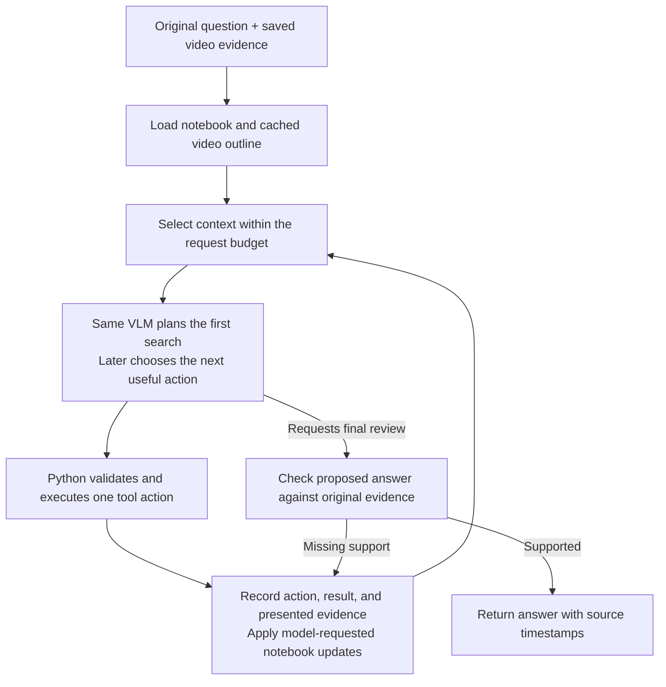

# Video Mammoth: Core Implementation Guide

Updated from the current source and saved collection on **2026-10-29**. This is the current progress and implementation plan for `/home/znyd/zent/video-mammoth`. The former rewrite workspace now lives at the project root; the legacy application has been removed.

Learn and implement from the top down: first show the coordinating function and the complete journey, then implement its helpers in execution order. Keep the agreed package structure. Give implementation code in chat for review unless file edits are explicitly requested.

## What is working now

| Milestone | Implemented behavior | Status |
| --- | --- | --- |
| Model clients | Typed async VLM/embedding clients, endpoint profiles, image serialization, response validation, model metadata, and connection cleanup | Implemented |
| 1. Video inspection | `probe_video` returns validated stream metadata and timeline origins | Complete |
| 2. Frame sampling | Persistent CUDA decoder, requested/actual timestamps, bounded parallel PNG saving | Complete; prior live check passed |
| 3. Subtitles and clips | Complete SRT cues, fixed maximum-30-second windows, overlapping cue references | Complete |
| 4. Prepared evidence | Save/reload source identity, frame records, cues, and clip references | Complete |
| 5. Embedding server | Resident local Qwen model; image/text inputs, instructions, configurable GPU batching | Complete; live client/server run passed |
| 6. Embedding workflow | Configurable visual perspectives per frame; one text vector per unique referenced subtitle cue | Complete |
| 7. Vector storage | Float32 `.pt` chunks, source IDs, checksums, validated lazy loading, bounded CPU cache | Complete; live save/reload passed |
| 8. Indexing integration | Prepare the full video, then embed, publish, and reload the completed collection | Functionally complete; performance work deferred |
| 9. Search | One query embedding per call, independent style/channel selection, CPU chunk scoring, ranked distinct clips with original source matches | Complete; user ran all three search modes |
| 10. VLM server | Resident local Qwen VLM, text/images, context validation, usage/status reporting, configurable thinking and inference settings | Complete for the current image-call milestone; user live check passed |
| 11–14. Investigation and answer review | Notebook, cached outline, original-question plus rewritten initial searches, model-chosen tools and follow-up searches, original evidence paging, paged answer review, saved outcomes and run limits | Implemented; offline integration checks pass; complete live investigation check remains |
| 15. Application API | Expose indexing and investigations through a shared application service | Planned; app folders have no implementation files |
| 16. CLI and web UI | Both interfaces call the same application API | Planned |

The next verification is a complete investigation through the actual model servers, including evidence inspection and answer review. Indexing performance work remains deferred.

### Investigation completion and run limits

`investigate()` in `investigation/coordinator.py` now connects the complete core path. `investigation/review.py` owns answer review; the existing `EvidenceReader` supplies original images and complete subtitle continuations. The same VLM performs planning, tool selection, and review.

- A finish request must cite valid sources whose full contents were presented during investigation. The current request's presented page counts, even before the next notebook snapshot is committed.
- Review automatically follows source-page cursors. Every assembled review request includes the question, proposed answer, bounded cumulative review findings, and the current original evidence page. It is counted with the supplied token counter.
- A page verdict is provisional. Completion requires checking all cited sources completely and a supported verdict with supporting references, no gaps, and no contradictions. A contradiction returns feedback to investigation immediately; unread sources remain recorded. The model can still misjudge evidence; this is a same-model review, not independent verification.
- `reviews.jsonl` records the finish proposal and each completed page assessment, source spans, model identity, and usage. `events.jsonl` records the investigation action/result. Subsequent investigation requests receive compact review feedback instead of all review pages.
- `_finish()` atomically publishes `result.json`, then marks `state.json` completed or incomplete. Results include original source timestamps, unresolved gaps, stop reason, model-call count, and elapsed seconds. An unverified proposal is stored separately from the final answer.
- `max_steps` remains the investigation action limit. Optional `InvestigationLimits` controls `max_model_calls` (default 128), `max_seconds` (3600), `max_no_progress_steps` (8), and `max_attempts` (2). One run-scoped VLM wrapper counts calls across outline generation, planning, action selection, retries, and review. The elapsed-time allowance also covers awaited embedding requests. Synchronous processing checks the deadline at execution boundaries.
- No-progress detection recognizes new evidence views, new search clip/source matches, notebook content changes, and new notebook read pages; changing retrieval scores or repeatedly writing identical notes does not count as new progress.
- Call/time limits retain completed review checks and identify cited sources still awaiting review. A finished run directory returns its saved result on another call. Use a new run directory to repeat an investigation with changed limits; automatic continuation of an interrupted review is not implemented.

The focused offline checks exercise supported completion, rejection returning to investigation, long cue continuations, exact image bytes, unknown/unpresented citations, global call limits, time cancellation, no-progress stopping, exhausted retries, journal reload, and atomic-file cleanup. They use fake model responses; they do not establish live answer quality. No temporary test scripts are retained.

## Verification history and fresh local state

All saved indexes, prepared frames, cached outlines, and notebook/run output were removed when promoting the workspace to the project root. There are currently no saved collections. Prepare and embed a video again to begin fresh. Source media remains local and ignored by Git.

The following table records earlier verification; it does not describe an index that currently exists.

| Saved run | Result |
| --- | --- |
| Source | `/home/znyd/zent/video-mammoth/reverse_eng.mp4` with `/home/znyd/zent/video-mammoth/reverse_eng.srt` |
| Video | 448.948 seconds, 1920 × 1080, 30 FPS |
| Preparation | 449 frames sampled at 1 FPS, 453 complete cues, 15 clips |
| Last clip | `[420, 448.948)` seconds |
| Visual channels | `ocr`, `objects`, `attributes`, `relationships`, `scene_actions`; 449 vectors each |
| Subtitle vectors | 453, one per unique referenced cue |
| Collection | 2,698 vectors; 2,048 dimensions; float32; L2-normalized; six `.pt` files |
| Storage | Schema version 2; maximum 4,096 rows per chunk |

The user reported successful live indexing/save/reload and searches for `Adobe` using general/all channels, OCR/all channels, and OCR/OCR-only. All-channel results included subtitle matches; OCR-only returned image matches. These confirm the exercised path, rather than comprehensive retrieval accuracy.

The user's VLM image check returned `completed` from `Qwen/Qwen3.5-2B`, with 277 input tokens and 50 output tokens. Earlier focused checks covered parsing/boundaries, storage integrity, clients, and configurable server behavior. Those temporary checks are not a maintained test suite; `tests` currently has no test files.

Earlier verification inspected source, configuration, and saved JSON metadata. The root migration rechecks workspace imports, default configuration paths, and offline persistence/retrieval behavior without loading model weights. It does not repeat GPU inference or the full indexing run. Embedding previously took at least 20 minutes; optimization and a real 10-hour benchmark remain deferred.

## Existing components and boundaries

See [the project layout](/home/znyd/zent/video-mammoth/README.md#project-layout) for the file map.

| Component | Responsibility |
| --- | --- |
| `media` | Inspect video, sample frames, read supplied SRT subtitles |
| `indexing` | Plan fixed clips, coordinate preparation, stream embedding batches |
| `storage` | Persist and validate prepared evidence and embedding collections |
| `retrieval` | Resolve one search instruction, embed a query, score channels, rank clips |
| `investigation` | Coordinate model-chosen searches, original evidence reads, notebook updates, bounded context, paged answer review, and saved outcomes |
| `model-clients` | Transport typed requests to local or compatible external model endpoints |
| `model-servers` | Load local weights once and serve inference requests |
| `apps` | Future application API, CLI, and web UI |

Contracts belong to the whole core and grow incrementally. Add only records required by the next runnable piece. The model clients provide the communication boundary; opening a client does not load or unload GPU weights.

### Operating modes

| Phase | Models loaded | Work |
| --- | --- | --- |
| Prepare evidence | Neither model required | GPU video decoding and bounded CPU image saving |
| Embed prepared evidence | Embedding model only | Finish sampling first; then embed image/text batches |
| Investigate questions | Embedding model plus VLM | Plan searches, embed query text, inspect original evidence, manage findings, review answers |

Both model servers are separate persistent processes. Keep their weights loaded across requests. When adding the VLM alongside the embedder, their settings must fit the available GPU memory. The recorded machine is an RTX 3060 with 12 GB VRAM; no new memory benchmark was run for this update.

### Configuration and startup

| File | What it controls |
| --- | --- |
| [models.toml](/home/znyd/zent/video-mammoth/config/models.toml) | Client base URLs, requested model IDs, capabilities, timeouts, optional API-key environment names, and embedding wire format |
| [servers.toml](/home/znyd/zent/video-mammoth/config/servers.toml) | Local model loading, dtype/device, attention implementation, image limits, batching, generation limits, and thinking |
| [embedding_prompts.toml](/home/znyd/zent/video-mammoth/config/embedding_prompts.toml) | Dynamic visual channels plus exact indexing/query instructions and subtitle instructions |

The client profiles currently point to local Qwen endpoints on ports 8001 and 8002. They contain real model IDs, rather than placeholders. Local profiles do not require an API key.

Both servers load their own section of `servers.toml` through validated settings. Use `VIDEO_MAMMOTH_SERVER_CONFIG` or `create_app(config_path=...)` to select another file. Restart the affected server after changing its settings; `/health` reports the loaded settings.

For the local VLM, `max_tokens` covers thinking, its closing marker, and the final answer together. With thinking enabled, `max_thinking_tokens` caps thinking at 2,048 tokens, while `min_answer_tokens` reserves at least 256 tokens for the answer. Smaller requests reduce the thinking allowance to preserve that reserve; requests below 258 tokens are rejected. Thinking may end naturally before the cap. At the cap the runtime generates `</think>` and continues into the answer within the same request and total output limit. These limits are configurable in `servers.toml`.

Run from `/home/znyd/zent/video-mammoth`, with one terminal per server:

```bash
uv run --package video-mammoth-embedding-server uvicorn video_mammoth_embedding_server.app:create_app --factory --host 127.0.0.1 --port 8001
```

```bash
uv run --package video-mammoth-vlm-server uvicorn video_mammoth_vlm_server.app:create_app --factory --host 127.0.0.1 --port 8002
```

Current defaults: embedding model `Qwen/Qwen3-VL-Embedding-2B`, GPU batch size 4, maximum request size 64 items, maximum image preprocessing size 1,048,576 pixels, and maximum input length 8,192 tokens. Core request batching defaults to 16 items; storage defaults to 4,096 rows. These are three independent settings.

The VLM is `Qwen/Qwen3.5-2B`, with an 8,192-token configured context, maximum 262,144 image preprocessing pixels, default output allowance 768 tokens, and a per-request output ceiling of 4,096. Thinking is configurable and currently **true**. With thinking enabled, the generated-token allowance covers thinking plus the final answer; the runtime returns the final answer text and counts all generated tokens in usage.

The local VLM endpoint accepts text/image chat completions and optional OpenAI-compatible `response_format` JSON Schema requests. Keep `supports_schema=true` for this endpoint. Schema requests use `lm-format-enforcer` to constrain only final-answer tokens and stop when the JSON is complete. The tokenizer lookup is built once and reused; ordinary text/image requests remain free-form. Search planning uses the existing client schema contract to request 1–`max_searches` variants, each at most `max_query_chars` characters (default 240). The original question is still added first without this variant-length limit. Completed JSON is validated again; truncated output is never treated as a valid action. The server does not implement native tool calls. After this dependency/code change, sync with `uv sync --all-packages --locked` and restart the VLM server in your terminal.

Provider swaps still require compatible capabilities and payload formats, not merely a different URL. Changing the embedding model/space requires a compatible rebuilt collection; the existing search validates available model identity, dimensions, and normalization.

## Evidence, storage, and search rules to preserve

- Visual clips remain fixed at a maximum of 30 seconds, with start-inclusive/end-exclusive windows. A sample requested at 30 seconds belongs to `[30, 60)`. Preserve actual decoded timestamps separately.
- Store every original subtitle cue once, with complete text and original timestamps. Every overlapping clip references its `cue_id`; clip boundaries never split cues or extend visual windows.
- Embed every frame once per configured visual channel, then every unique referenced subtitle cue once. Total vectors = frames × visual channels + unique indexed cues. There is no additional transcript vector per clip.
- Tensor files contain float32 vectors and int64 frame/cue IDs. Original text, image paths, and timestamps stay in the preparation. Shared cues need no second vector-reference list in clips.
- The writer stages a new collection, validates complete coverage, and publishes it through `finish()`. Handled failures remove staging output. This does not implement interruption/resume.
- The reader lazily validates chunks and uses a default 256 MiB CPU tensor cache. A 4,096 × 2,048 float32 matrix is 32 MiB before IDs/file overhead. This bounds cached tensors, not all process memory.
- Each search embeds its text once with one general/preset/custom instruction. Channel scope is independent; omitted channels means all. Custom instruction overrides style.
- Current scoring uses CPU `vectors @ query_vector`, then ranks each clip by its best matching source. A cue contributes to every referencing clip before the unique-clip limit. Matching source IDs, original times, channels, and scores remain available.
- Search scans selected channels and keeps source-score mappings. Initial investigation searches merge clip rankings using reciprocal rank fusion. There is no implemented clip-specific chunk selection, ANN index, or calibrated confidence probability.

After creating a new index, prepared evidence and the completed collection can be reused without re-embedding for later investigations. Current preparation settings default to decode batch size 4, four saving workers, and 16 pending frames; the lower-level sampler independently defaults to decode batch size 8. Performance measurements should state the settings used.

## Investigator design

Use **one agent and the same VLM** for outlining, planning, evidence assessment, findings/memory management, answer writing, and answer review. No extra reasoning model or new model server is required.

The VLM chooses the investigation path. Python owns valid execution, persistent records, source tracking, and configurable budgets. The original user question remains the answer goal; generated search wording and working goals are separate.



### Outline and initial search planning

1. At the first investigation, load or build a question-independent video outline from the unique saved cues in chronological order. This happens when the VLM is available; indexing still requires only the embedder.
2. Summarize manageable batches, save detailed section outlines, and combine all section summaries into a bounded overview. Use additional summary levels for long videos; keep every detailed section accessible through `read_outline`.
3. Cache by source/preparation identity, model identity, prompt version, and relevant settings. Preserve source references and original time ranges. If subtitles are unavailable, explicitly report that a subtitle outline is unavailable and let investigation proceed; a visual overview is an optional later enhancement.
4. Give the VLM the original question and bounded video overview. It generates up to `max_searches` additional query variants, each within `max_query_chars`; Python includes the unchanged original question first and removes repeated queries. Initial queries all use the general embedding instruction and search all indexed channels. Later investigation searches may choose other styles, channels, and custom instructions. Query variants are hypotheses to investigate, not new answer requirements. Planning retries invalid responses, truncated or invalid plans, and client errors marked retryable within `max_attempts` (default 2 total calls). Transient client retries wait `retry_delay_seconds` (default 1 second); authentication, invalid-request, unsupported-capability, and other non-retryable client errors fail immediately. Model refusals and budget violations also fail immediately.
5. `run_initial_searches()` executes the plan through the existing `search_index`. Multiple planned queries mean separate calls, each with one query embedding and general/all-channel search settings. Clip IDs are ordered by reciprocal rank fusion while retaining each query's source matches, ranks, and scores. Follow-up search results place their candidates first in the next bounded brief; scores remain specific to their individual queries.

The outline is navigation guidance and cannot support a final claim by itself. It can omit topics, and subtitle-only input cannot establish unseen visual facts. Outline time ranges do not automatically restrict global search.

### Tools and model-managed memory

The validated tool set is `search`, `open_clip`, `open_neighbor`, `read_sources`, `read_outline`, `read_notebook`, `write_notebook`, and `request_finish`. One VLM decision proposes one action; each search action embeds one query. Python validates and dispatches through explicit branches.

Notebook operations let the VLM read, add, and update findings, its working plan, and unresolved questions. Findings carry original source references and distinguish observations, interpretations, uncertainty, and contradictions. Corrections retain history. The VLM decides which findings to record; Python does not turn a high search score into a supported fact.

Store current investigation state plus an append-only event history, provisionally `state.json` and `events.jsonl` under a run directory. Scope records to the preparation/collection and question. Automatically log validated actions, results, errors, and actual evidence presentation. Large payloads and original images/cues remain in evidence storage or are referenced from saved results instead of copied into every notebook entry.

Saved history may grow; the next model request stays bounded. Keep the original question, active working state, relevant findings, gaps, and the latest evidence in a compact brief. Older notebook entries are available through paged reads; the event journal remains on disk for inspection. Resident model weights do not preserve investigation memory between stateless API calls.

### Request budgets, paging, and future context selection

Keep context selection behind a small replaceable interface. Initially use understandable selection rules; later a decision model can select notebook/evidence references through the same interface. Python still validates references, loads content, and enforces budgets. The model can request older or different evidence using tools.

Budget the assembled request: instructions, question, tool descriptions, selected notebook context, subtitle text, images, formatting, and output reserve. With thinking enabled, reserve generated space for thinking and the answer. A 30-second clip does not guarantee context fit.

The core uses the caller's `count_tokens` boundary for assembled requests. The local `LocalTokenCounter` counts text and processed visual tokens using the cached Qwen processor without loading model weights. The VLM server independently checks processed input plus output allowance. A provider swap needs an appropriate counter; this is not a provider-independent multimodal tokenizer. Evidence is paged to fit, optional decision summaries can be omitted, and essential content that cannot fit produces an explicit budget failure.

Return whole cues where they fit, plus explicit continuation cursors for unshown evidence. If a single cue is oversized, present its text in continuation pages with exact text offsets while retaining the complete original cue, ID, and timestamps. These are display pages, not new stored cues or embeddings. Never invent word times or mark an unread remainder as inspected.

Track retrieved candidates, evidence actually presented, and model-assessed findings separately. Showing a subset of a clip's images or cue text does not mean the whole clip was inspected. Save unpresented continuations so they remain recoverable.

### Answer review and stopping

The VLM requests completion with a proposed answer and source references. Python checks source identity and recorded presentation; a separate call to the same VLM reviews claims against original cues/images, using bounded pages where necessary. Review gaps return to investigation. A model's supported verdict is not an independent correctness guarantee.

Configure maximum steps, elapsed time, request/retry limits, and evidence budgets. Invalid actions, context failures, and repeated no-progress work receive bounded feedback rather than endless retries. If support remains missing when limits are reached, save and return an explicitly incomplete result with its gaps.

## How we will build it

Keep the existing investigation folder and planned responsibilities. Add contracts only when the next runnable piece needs them; avoid creating empty files just to fill a tree.

| Order | Proposed piece | Purpose / first check |
| --- | --- | --- |
| 1 | Coordinator skeleton (`coordinator.py`) | Show the whole journey first, with explicit helper interfaces/stubs; walk through one simulated action |
| 2 | Minimal shared contracts (`contracts.py`) | Validate actions, findings, source references, continuations, state, and results |
| 3 | Notebook and tool dispatch (`notebook.py`, `tools.py`) | Persist and reload a model-requested finding; reject bad actions/references; retain updates in history |
| 4 | Outline and planning (`outline.py`, `planning.py`) | Cache chronological summaries; generate useful initial searches through the existing VLM client |
| 5 | Evidence tools, context, and budgets (`tools.py`, existing `context.py` / `budget.py`) | Attach actual images/cues, paginate oversized evidence, build bounded briefs, and record what was shown |
| 6 | Complete the coordinator loop | Repeatedly ask the VLM, validate, execute, record, and continue using configurable limits |
| 7 | Verification and completion (`review.py`, `_finish()` in `coordinator.py`) | Implemented: review original evidence across pages, return gaps to investigation, and save a cited or explicitly incomplete outcome |

Use separate prompts for these jobs through the same VLM client; keep prompts with their owning responsibility initially. Related helpers can stay together. Future filenames describe responsibilities, not a requirement to split every small function into another file.

Focused acceptance checks: a straightforward question; a question needing a rewritten search and another clip; a shared cue leading to both overlapping clips; oversized cues/images with continuations; long notebook history with paged reads; invalid/truncated actions; unsupported answers returning to investigation; and stopping with saved gaps when budgets run out. Keep deterministic persistence/budget/provenance checks separate from live model-quality checks.

## After the investigator / deferred work

The application API will own application-level startup/configuration and expose indexing/investigation jobs. CLI and React/other web UI will both call that API. The local model servers remain inference-only services. Application packages, routes, jobs, and interfaces are not implemented or registered as workspace packages yet.

Deferred: indexing performance tuning, detailed progress, persistent partial checkpoints/resume, automated workflow startup, manual subtitle/video alignment assessment, broader retrieval/answer evaluation, a maintained test suite, and representative 10-hour throughput/memory measurements. The current chunk format supports incremental vector loading, but does not establish end-to-end long-video performance.
