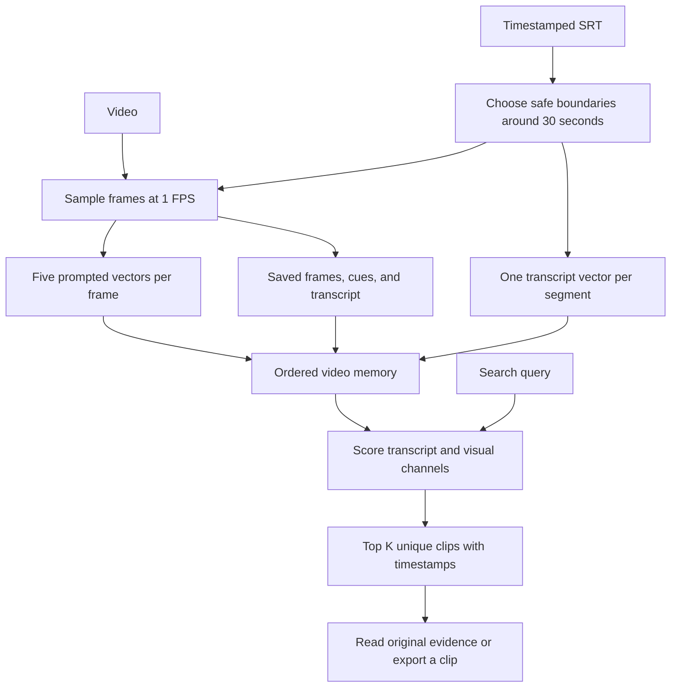

# video-mammoth

Local video memory using a timestamped SRT transcript and several prompted image
embeddings per sampled frame. Qwen3-VL-Embedding-2B is the default. Model inference,
video decoding, and similarity calculations default to CUDA.

This implementation takes an existing video and SRT. It does not run speech-to-text,
generate frame descriptions, embed audio, or orchestrate an LLM.

## Run

Use `uv` from the project directory. FFmpeg and FFprobe must be installed on the
system; the Python dependencies are managed by `pyproject.toml` and `uv.lock`.
Your installed CUDA PyTorch packages are retained.

```bash
uv run main.py index data/video.mp4 --srt data/video.srt --output memory/my_video

uv run main.py query "a shoe rack beside the door" \
  --index memory/my_video --top-k 6 --output candidates.json

uv run main.py show 000003 --index memory/my_video

uv run main.py export 000003 --index memory/my_video --output data/clip_000003.mp4

uv run main.py list
```

`show` returns the full transcript, original timestamped subtitle cues, and every
sampled frame's absolute path. `export` creates an MP4 and a matching SRT with
timestamps relative to the exported clip. Physical MP4 segments are only rendered
when requested. Export retains the original soundtrack when present.

All commands accept `--json` for machine-readable stdout. Model progress goes to
stderr. `query` also accepts `search` as an alias.

## What indexing does

1. Read the SRT and group overlapping subtitle cues.
2. Form contiguous, non-overlapping segments around 30 seconds, preferring
   sentence endings within 5 seconds of the target boundary.
3. Sample the video on a global one-frame-per-second grid and save lossless PNGs.
4. Encode each frame once per visual instruction. The defaults are OCR, objects,
   attributes, relationships, and scene/actions.
5. Encode the segment's subtitle text separately, without soundtrack embeddings.
6. Save evidence and normalized PyTorch vectors under ordered clip IDs.

SRT timestamps describe whole cues, not individual words. The segmenter never
splits a cue's text or estimates word timings. When there is no nearby sentence
ending, it uses a safe cue boundary or a timestamp in a gap. An unusually long
cue, or a continuous group of overlapping cues, can therefore produce a segment
longer than 30 seconds. Accuracy of subtitle timing depends on the supplied SRT.
Very short trailing segments are folded into the previous segment.
Subtitle text is preserved; formatting tags are removed only for text embedding.
Blank caption rows are accepted. The final caption may end after the video;
its original timing is preserved, while the final segment stops at the video end.

Silence and footage outside the subtitle range are still indexed. Those segments
have frame vectors and no transcript vector. Repeated/rolling subtitle text is
kept as supplied. Supply a cleaned SRT if the captions contain unwanted repetition.

For nonzero video presentation timestamps, metadata retains the source timeline
origin. Each saved frame has both its requested sample time and its actual frame
presentation time relative to the video's playback timeline. Export timestamps
follow this same timeline; rendered boundaries are limited by video frame timing.

```bash
uv run main.py index data/video.mp4 --srt data/video.srt \
  --fps 1 --clip-seconds 30 --boundary-slack 5 \
  --batch-size 1 --max-pixels 1048576
```

`--subtitle-offset 1.5` shifts all subtitle cues 1.5 seconds later. The original SRT
is also copied unchanged to the memory. If a codec cannot decode on CUDA, select
`--decode-device cpu`; the embedding model still stays on CUDA. `--device cpu`
explicitly selects CPU inference when needed.

PNG saving runs on a bounded thread pool. Inference uses one model and bounded
batches to avoid multiple model copies competing for the 3060's VRAM.

## Prompts and model choice

Edit `prompts.json`, or pass another file through `--prompts`. Each visual entry
has a unique name, an image `instruction`, and a matching `query_instruction`.
The file also holds the transcript and transcript-query instructions. Add or
remove visual entries to change the number of vectors per frame. The effective
configuration is copied into the index, so editing the defaults does not change
the meaning of an existing index.

```bash
uv run main.py index data/video.mp4 --srt data/video.srt \
  --model wemm --output memory/video_wemm

uv run main.py index data/video.mp4 --srt data/video.srt \
  --model Qwen/Qwen3-VL-Embedding-8B --output memory/video_qwen8b
```

Aliases are `qwen` -> `Qwen/Qwen3-VL-Embedding-2B` and
`wemm` -> `tencent/WeMM-Embedding-2B`. WeMM enables its publisher's custom model
code and uses its query/document encoding methods. Other Sentence Transformers
model IDs or local model paths can be supplied directly; their image-input and
instruction interfaces must be compatible. Use `--trust-remote-code` only for
models whose custom code you intend to load. Not every embedding architecture is
interchangeable by name alone. Search automatically loads the index's saved model
and checkpoint revision.

Instructions are experimental guidance, not guarantees of complete OCR, object
coverage, or action understanding. A single frame cannot establish event order
or motion; this version intentionally stores individual-frame embeddings.

## Memory format

```text
memory/my_video/
├── manifest.json                 video ID, model, prompts, settings, ordered clips
├── source.srt                    unchanged input subtitles
└── clips/
    ├── 000000/
    │   ├── metadata.json         boundaries, original cues, frame timestamps/paths
    │   ├── transcript.txt
    │   ├── subtitles.srt         selected cues, using global video timestamps
    │   ├── embeddings.pt
    │   └── frames/
    │       ├── frame_000000000.png
    │       └── ...
    └── 000001/
        └── ...
```

Each PyTorch file contains `frames` with shape `[frame_count, prompt_count, D]`
and `transcript` with shape `[D]`, or `None` for a segment without subtitle text.
For Qwen 2B, `D = 2048`. One frame therefore has a `[5, 2048]` matrix by default.
Vectors are normalized float32 tensors stored on CPU and loaded with
`weights_only=True`. Frames and subtitles remain independent evidence files.

The video is referenced by absolute path. Add `--copy-video` during indexing to
store a video copy inside the memory so it can be moved with the index.

Without `--output`, a unique directory name is derived from video content, SRT
content, model, prompts, and indexing settings. Different source videos cannot
accidentally share an index. A different recipe requires a different explicit
output directory. Rerunning the same command resumes incomplete indexes, skipping
completed clips. Metadata and tensor files are written atomically. An incomplete
index is not searchable until indexing finishes.
Use one indexing process per output directory.

## Ranking

For each selected channel, encode the search query with its saved query
instruction. Transcript similarity is computed against the clip's text vector.
Each visual channel uses the strongest frame similarity in the clip. The default
final score is the maximum over those channel scores, so a briefly visible detail
can retrieve the segment without averaging it away. Each clip appears once.

```bash
uv run main.py query "737" --index memory/my_video --channels ocr --top-k 6

uv run main.py query "the speaker explains policy gradients" \
  --index memory/my_video --channels transcript --top-k 6

uv run main.py query "a blue bottle" --index memory/my_video \
  --channels objects attributes --fusion rrf --top-k 6
```

`--fusion rrf` combines per-channel clip ranks using reciprocal rank fusion,
`sum(1 / (60 + rank))`, rather than comparing raw similarity magnitudes across
instructions. It favors agreement across channels. `--frame-top-n 3` averages the
three highest frame scores per channel instead of retaining one peak. These
choices are exposed for experiments; neither guarantees the best ranking for
every query. `--query-instruction` overrides query guidance for an individual run.

Results include clip boundaries in `MM:SS.mmm` or `HH:MM:SS.mmm`, raw seconds,
channel scores, strongest matching frame per visual channel, transcript text, and
metadata paths. Similarity and RRF scores are ranking values, not probabilities.

## Reuse as tools later

```python
from pathlib import Path
from video_memory.encoder import EmbeddingModel
from video_memory.indexing import index_video
from video_memory.media import export_clip
from video_memory.retrieval import search
from video_memory.storage import get_clip

index = index_video(Path("data/video.mp4"), Path("data/video.srt"))
model = EmbeddingModel("qwen")
candidates = search(index, "a blue bottle", top_k=6, model=model)
evidence = get_clip(index, candidates["candidates"][0]["clip_id"])
# Optional: export_clip(index, evidence["clip_id"], Path("data/evidence.mp4"))
```

Pass a model matching the index's checkpoint to reuse GPU weights across searches.
The functions return paths or JSON-serializable dictionaries; they do not call an
agent or depend on an orchestration framework.

## Code map

| File | Responsibility |
|---|---|
| `main.py` | CLI entry point |
| `video_memory/cli.py` | Arguments and display |
| `video_memory/subtitles.py` | SRT parsing, segmentation, timestamp formatting |
| `video_memory/media.py` | Video timeline, frame sampling, MP4 export |
| `video_memory/encoder.py` | Model loading and prompted GPU embeddings |
| `video_memory/indexing.py` | Index preparation, evidence preparation, resumable embedding |
| `video_memory/storage.py` | Manifest, tensors, index listing, evidence access |
| `video_memory/retrieval.py` | Query encoding, clip scoring, ranking |
| `prompts.json` | Editable instructions |


