# Video Mammoth: architecture and system walkthrough

This is the standalone architecture reference for the code at the repository root, as inspected on **29 October 2026**. It brings the system design, execution flow, configuration, persistence rules, verification status, and remaining work into one document. The legacy application and the separate implementation guide have been removed.

The goal is to understand **what calls what, which objects move between those calls, and what each call produces**. You can then open an individual function and study its internals without losing your place in the whole system.

All video content, search results, model choices, and answers in the running example below are invented. They illustrate possible execution; they are not results from your saved videos.

## How to read this guide

For a first human walkthrough, read sections **1–4**, then follow sections **5–17** in order. The function tables belong to the surrounding explanation: you do not need to open every helper immediately.

For an agent joining the repository, start with **section 0**, then use the linked sections for the part being changed. Sections **18–23** are the configuration, limits, data, code-location, and verification reference. The source code remains authoritative if it changes after this document.

- [0. Agent orientation](#0-agent-orientation)
- [1. The three jobs](#1-the-three-jobs)
- [2. The packages and processes](#2-the-packages-and-processes)
- [3. Our invented video and its data](#3-our-invented-video-and-its-data)
- [4. Where execution starts](#4-where-execution-starts)
- [5. Preparing video and subtitles](#5-preparing-video-and-subtitles)
- [6. Making and saving embeddings](#6-making-and-saving-embeddings)
- [7. Reopening the saved material](#7-reopening-the-saved-material)
- [8. Entering the investigator](#8-entering-the-investigator)
- [9. Getting the outline and planning the first searches](#9-getting-the-outline-and-planning-the-first-searches)
- [10. Turning a query into ranked clips](#10-turning-a-query-into-ranked-clips)
- [11. Building one model decision](#11-building-one-model-decision)
- [12. Opening original evidence and continuing through pages](#12-opening-original-evidence-and-continuing-through-pages)
- [13. Saving progress in the notebook](#13-saving-progress-in-the-notebook)
- [14. Searching again and using the other actions](#14-searching-again-and-using-the-other-actions)
- [15. Proposing and reviewing an answer](#15-proposing-and-reviewing-an-answer)
- [16. Finishing and saving the outcome](#16-finishing-and-saving-the-outcome)
- [17. One possible investigation from question to answer](#17-one-possible-investigation-from-question-to-answer)
- [18. The model clients and local servers](#18-the-model-clients-and-local-servers)
- [19. Budgets, limits, errors, and recovery](#19-budgets-limits-errors-and-recovery)
- [20. What is saved, and what remains to test](#20-what-is-saved-and-what-remains-to-test)
- [21. A map of the data types](#21-a-map-of-the-data-types)
- [22. Where to go deeper in the code](#22-where-to-go-deeper-in-the-code)
- [23. Verification status and next work](#23-verification-status-and-next-work)

## 0. Agent orientation

### What exists today

Video Mammoth is a Python/UV research workspace. It answers questions about a video by searching instruction-guided image/text vectors, reading the original sampled images and supplied subtitles, and using one VLM to manage an investigation. The same VLM also builds navigation summaries, rewrites initial searches, and reviews proposed answers.

There are **four installed workspace packages**. Their distribution names and import names differ:

| Directory | UV package name | Python import | Owns |
| --- | --- | --- | --- |
| `packages/core/` | `video-mammoth-core` | `video_mammoth_core` | Preparation, indexing, storage, retrieval, investigation. |
| `packages/model-clients/` | `video-mammoth-models` | `video_mammoth_models` | Common model contracts and compatible HTTP clients. |
| `model-servers/embedding/` | `video-mammoth-embedding-server` | `video_mammoth_embedding_server` | Local embedding inference service. |
| `model-servers/vlm/` | `video-mammoth-vlm-server` | `video_mammoth_vlm_server` | Local VLM inference service and optional local token counter. |

The root project is a UV workspace with `package = false`; it is not a fifth application package. `apps/api/`, `apps/cli/`, `apps/web/`, and `tests/` contain placeholders. There is no implemented application HTTP API, CLI command, web interface, or maintained test suite. The two **model HTTP APIs** are implemented and separate from the future application API.

### Find the owning module

All core paths below are inside `packages/core/src/video_mammoth_core/`:

```text
contracts.py                 Shared typed records, actions, budgets, notebook state
media/
  video.py                   Probe metadata and sample/save frames
  subtitles.py               Read original SRT cues
indexing/
  prepare.py                 Coordinate preparation
  segments.py                Fixed clips, overlapping cues, neighbors
  embed.py                   Coordinate embedding batches
storage/
  prepared.py                Preparation manifest and source validation
  embeddings.py              Chunk writer, collection metadata, lazy vector reader
retrieval/
  search.py                  One query vector → source scores → candidate clips
investigation/
  coordinator.py             Whole investigation, action dispatch, stopping, result
  outline.py                 Cached subtitle outline and bounded overview
  planning.py                Original question plus generated search variants
  context.py                 System prompt and bounded decision request
  evidence.py                Read original sources into fitting pages
  tools.py                   Execute follow-up search and evidence/notebook actions
  notebook.py                Current notes, action journal, snapshot recovery
  review.py                  Re-read cited originals and assess answer support
  budget.py                  Request checks, token-count cache, limit exceptions
```

In `video_mammoth_models`, start with `contracts.py`, `config.py`, and `factory.py`; then follow `vlm.py` or `embeddings.py`. `content.py` serializes image/text content and `errors.py` defines common failures. Each model server has `app.py`, `config.py`, and `runtime.py`; the VLM server also has `counting.py` and `structured.py`.

Core calls the client protocols. It does not import either local runtime or own model weights. A caller can choose `LocalTokenCounter` from the VLM server package, but core accepts any suitable `GenerationRequest → int` callable. Local model inference is reached through HTTP, not by calling the server runtime from core.

### Start at the coordinating call

| Task | Start here | Main handoff | Read next |
| --- | --- | --- | --- |
| New video and SRT | [probe_video()][video.probe_video] → [prepare_video()][prepare.prepare_video] | `VideoInfo` and sample times → `PreparedEvidence`, PNGs, manifest | [Preparation](#5-preparing-video-and-subtitles) |
| Build vectors | [embed_prepared()][embed.embed_prepared] | Evidence + embedding client + prompts → saved `EmbeddingCollection` | [Indexing](#6-making-and-saving-embeddings) |
| Reuse an index | [load_prepared()][prepared.load_prepared] → [open_embeddings()][store.open_embeddings] | Directories → evidence catalog and lazy `EmbeddingStore` | [Reloading](#7-reopening-the-saved-material) |
| One search | [search_index()][search.search_index] | `SearchRequest` → ranked `SearchResult` with source matches | [Retrieval](#10-turning-a-query-into-ranked-clips) |
| Answer a question | [investigate()][coordinator.investigate] | Question + evidence/store/clients/budgets → saved outcome dictionary | [Coordinator inputs](#8-entering-the-investigator) |
| Start local inference | Each server's `app.create_app()` | Settings → resident runtime → HTTP inference | [Model services](#18-the-model-clients-and-local-servers) |

These calls are connected by a caller today; there is no hidden video-to-answer launcher. Preparation needs no model server. Indexing needs only the embedder. Investigation needs the embedder and VLM. Keeping servers running retains their weights; keeping clients open retains HTTP connections.

### Behavior that defines the current design

1. **Clips are references, not cut video files.** Windows are fixed, at most 30 seconds, and include their start but exclude their end. Frame membership uses requested sample time; actual decoded time is retained separately.
2. **Cues keep their identity and full text.** Every overlapping clip references the same cue ID. Each referenced cue gets one vector per collection, even if it overlaps several clips. Identical text under different cue IDs is still different source material.
3. **Visual channels are configurable instructions.** Every frame gets one vector per configured perspective. OCR is an embedding perspective, not a separate OCR-text extraction stage. There is no per-clip transcript vector.
4. **One search makes one query vector.** Its instruction and selected channels are independent. Initial searches use general/all-channel settings; follow-up searches can change either. Matching a shared cue makes all referencing clips candidates.
5. **Retrieval is navigation, not proof.** Opening original sources is a separate action. Outline text, vector scores, and notebook hypotheses do not become original evidence merely by entering the prompt.
6. **The model requests; Python executes.** One decision returns an `ActionRequest` JSON object. The schema and explicit dispatcher implement tool use; provider-native `tool_calls` are not used.
7. **Memory is explicit and bounded in the prompt.** Selected note previews, candidate summaries, and the latest result/evidence enter the next request. The full journal stays on disk. The VLM server holds weights, not a persistent investigation conversation.
8. **Reading and delivery are separate.** A read prepares page metadata; the next decision request attaches original content. Full-cue presentation is tracked by character coverage. Review then re-reads cited originals before accepting completion.
9. **Limits are independent.** Clip duration, page size, token allowance, steps, total VLM calls, elapsed time, and no-progress stopping solve different problems. The first reached run limit can end an investigation even when other allowances remain.
10. **Identity binds saved artifacts.** Preparation, collection, and run IDs prevent mixing unrelated data. Saved vectors include exact instructions and available model metadata; matching dimensions alone does not establish a compatible embedding space.

See [section 20](#20-what-is-saved-and-what-remains-to-test) for current gaps, including review scope and incomplete resume support. See [section 23](#23-verification-status-and-next-work) before treating an implemented path as fully tested.

## 1. The three jobs

The system first turns a video into material that can be searched. Later, it uses that material to investigate a question.

| Job | What goes in | What happens | What comes out |
| --- | --- | --- | --- |
| **Prepare** | Video, SRT, requested sample times | Save sampled images, read complete subtitle cues, arrange references into fixed clips | `PreparedEvidence` and saved PNG files |
| **Index** | Prepared evidence and configured embedding instructions | Embed each frame under each visual perspective, then each referenced subtitle cue once | A saved `EmbeddingCollection` |
| **Investigate** | Question, prepared evidence, saved collection, model clients | Plan searches, inspect originals, keep notes, search again, propose and review an answer | A saved completed or incomplete outcome |

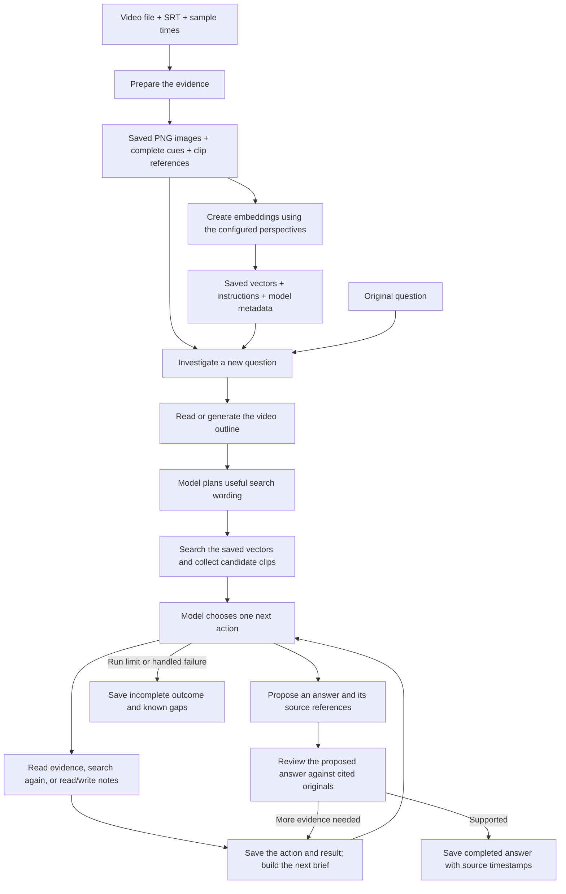

Two facts make the rest easier to follow:

1. **The vectors help locate evidence.** They do not replace the images or subtitle text. The model must inspect original evidence to make a supported finding.
2. **The VLM chooses actions; Python executes them.** The VLM does not directly open a file, multiply vectors, or write the notebook. It returns a typed request telling Python which operation it wants.

## 2. The packages and processes

There are two Python packages doing application work and two local model-server packages. The application API, CLI, and web directories are currently empty placeholders.

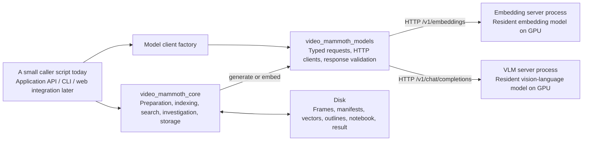

| Location | Its responsibility |
| --- | --- |
| `packages/core/.../media/` | Understand video metadata, sample frames, read SRT files. |
| `packages/core/.../indexing/` | Make fixed clip references, coordinate preparation, send evidence for embedding. |
| `packages/core/.../storage/` | Save/reload prepared evidence and chunked vector files. |
| `packages/core/.../retrieval/` | Turn one text query into scored sources and ranked clips. |
| `packages/core/.../investigation/` | Coordinate the model, tools, context, notes, evidence pages, and answer review. |
| `packages/core/.../contracts.py` | Define the objects passed between those pieces. |
| `packages/model-clients/` | Translate common model requests into the configured HTTP format and translate responses back. |
| `model-servers/embedding/` | Load the local embedding model once and serve embedding requests. |
| `model-servers/vlm/` | Load the local VLM once and serve generation requests. |
| `apps/api`, `apps/cli`, `apps/web` | Reserved places for application interfaces; no current implementation. |

**During indexing**, you can run only the embedding server. Creating the two HTTP client objects does not load either model and does not send a VLM request. The VLM server is unnecessary for `embed_prepared()`.

**During investigation**, the embedding server handles search-query vectors, while the VLM handles the outline, search planning, action decisions, and answer review. These jobs use the same VLM endpoint; they are different requests with different prompts.

The model servers remain separate processes. Leaving a server running keeps its model loaded. Leaving an HTTP client open keeps reusable HTTP connections available. These are two different lifetimes.

## 3. Our invented video and its data

Imagine a **95-second video** called `filter_repair.mp4`. Leena explains a leaking water filter, removes the damaged housing, installs a replacement, and performs a short leak test. Its SRT contains six cues.

We request one image at every integer second from `0` through `94`. For this example, assume the source has frames at exactly those times and each saved image is 1920 × 1080.

| Internal cue ID | Original interval | Complete subtitle text |
| --- | --- | --- |
| 0 | 5–9s | First close the inlet valve. |
| 1 | 23–35s | The housing has a crack, so tightening the cap will not fix the leak. |
| 2 | 35–49s | Use a strap wrench to loosen the housing without crushing it. |
| 3 | 58–64s | The new housing fits onto the same bracket. |
| 4 | 82–87s | There are no leaks during this short test. |
| 5 | 91–94s | The valve is open again. |

At 43s, the picture clearly shows Leena holding a **blue strap wrench**. Near 52s, the picture contains the written label **INLET**. These invented visual details will help explain different search styles.

The fixed clips are references into the saved material:

| Clip ID | Visual window | Frame IDs at this sample rate | Referenced cue IDs |
| --- | --- | --- | --- |
| 0 | `[0, 30)` | 0 through 29 | 0, 1 |
| 1 | `[30, 60)` | 30 through 59 | 1, 2, 3 |
| 2 | `[60, 90)` | 60 through 89 | 3, 4 |
| 3 | `[90, 95)` | 90 through 94 | 5 |

`[30, 60)` means “include the start, exclude the end.” A sample requested at exactly 30s belongs to clip 1. Cue 1 overlaps clips 0 and 1, so both reference it. Its stored text and interval remain **23–35s** in both cases.

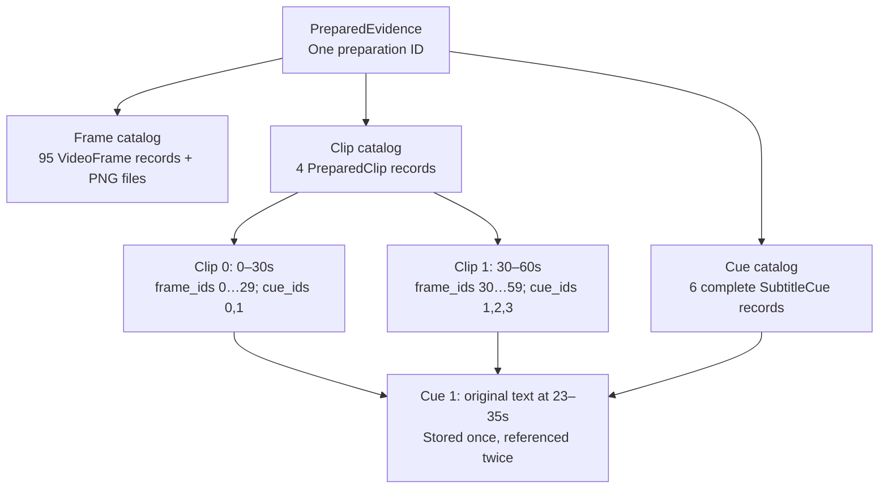

### Understand the IDs before following calls

| ID | What it identifies | Example meaning |
| --- | --- | --- |
| `preparation_id` | One prepared set of frames, cues, and clips | The prepared filter-repair evidence. |
| `collection_id` | One saved embedding collection | Those sources embedded with a particular set of prompts/model settings. |
| `configuration_id` | A hash of the embedding recipe and model metadata | Allows the store to check that the saved configuration agrees with its identity. |
| `frame_id` | One sampled image within a preparation | Frame 43, which happens to be requested at 43s in this example. |
| `cue_id` | One subtitle cue within a preparation | Cue 1, covering 23–35s. |
| `clip_id` | One fixed visual window | Clip 1, covering 30–60s. |
| `run_id` | One investigation notebook | One attempt to answer our question. |
| `entry_id` | One note in that notebook | Note 0 about the cracked housing. |
| `review_id` | One proposed-answer review attempt | The review of a particular proposed answer. |

Frame IDs are **sample positions**, not universal timestamps. If you sampled every two seconds, frame 43 would be requested around 86s. Cue IDs are assigned internally from SRT cue order; they are not necessarily the printed SRT counters. A `SourceReference(source_kind="cue", source_id=1)` identifies cue 1, **not clip 1**.

## 4. Where execution starts

There is currently **no single application function that accepts a video and performs every phase automatically**. A small caller connects the public functions. Later, an application service can do this behind API and CLI interfaces.

This skeleton is a map of calls, not a complete runnable script. Imports, paths, settings, and error handling are intentionally omitted so the main sequence is visible.

```python
# Phase A: prepare. No model requests.
video = probe_video(video_path)
evidence = prepare_video(
    video,
    seconds=sample_times,
    output_directory=prepared_directory,
    subtitle_path=srt_path,
)

# Phase B: index. Only the embedding model is needed.
profiles = load_profiles("config/models.toml")
prompts = load_embedding_prompts("config/embedding_prompts.toml")
async with create_model_clients(profiles) as clients:
    collection = await embed_prepared(
        evidence,
        clients.embeddings,
        prompts=prompts,
        output_directory=collection_directory,
    )

# Phase C: answer a question, possibly in a later process.
evidence = load_prepared(prepared_directory)
store = open_embeddings(collection_directory, evidence=evidence)
async with create_model_clients(profiles) as clients:
    outcome = await investigate(
        question,
        evidence=evidence,
        store=store,
        clients=clients,
        # Also supply run_directory, budget, max_steps,
        # outline_directory, outline_cache_identity,
        # count_tokens, and general_instruction.
    )
```

Start reading the real code at [prepare_video()][prepare.prepare_video], [embed_prepared()][embed.embed_prepared], and [investigate()][coordinator.investigate]. Those are the three main coordinating functions. Each calls smaller pieces with a clear job.

Here is the investigation coordinator at one level of abstraction. This is also a skeleton rather than a copy of its implementation:

```python
notebook = open_or_load_this_run()
outline = await get_outline(...)
plan = await plan_searches(question, outline, ...)
initial = await run_initial_searches(plan, ...)
reader = EvidenceReader(evidence, outline, budget)

for each_remaining_step:
    request = build_context_from_current_state(...)
    action = await choose_one_valid_action(request)

    if action is a finish_request:
        result = await review_answer(...)
    elif action is a search_request:
        result = await execute_search(...)
    else:
        result = execute_tool(...)

    notebook = record_step(notebook, action, result, ...)
    if answer_review_supports_completion:
        break
    remember_a_small_latest_result_for_the_next_step()

return save_final_outcome(...)
```

The next sections expand those boxes in the order they happen.

## 5. Preparing video and subtitles

### The input and output

**Input:** a video path, a caller-chosen sequence of sample times, an SRT path, and preparation settings.

**Output:** a [PreparedEvidence][types.PreparedEvidence] object describing everything prepared, plus a directory containing the images and `manifest.json`.

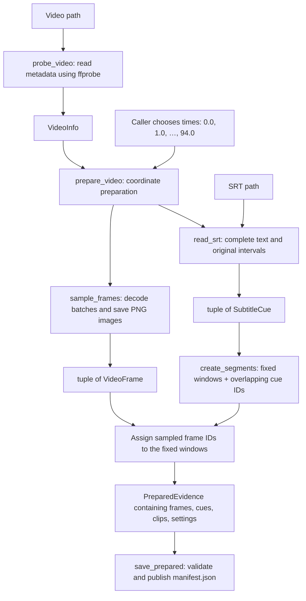

### Follow the functions

| In order | Function | What it takes → what it produces |
| --- | --- | --- |
| 1 | [probe_video()][video.probe_video] | Video path → `VideoInfo`: resolved path, selected stream, duration, dimensions, codec, frame rate when available, and timestamp origins. It inspects metadata; it does not sample images. |
| 2 | [prepare_video()][prepare.prepare_video] | `VideoInfo`, sample times, output directory, SRT, decode/save settings → fully prepared evidence. This function connects the following operations. |
| 3 | [identify_source()][prepared.identify_source] | A source path → `SourceFile(path, size_bytes, modified_ns)`. Later loading checks whether the source file still matches. This is a size/mtime identity check, not a content hash. |
| 4 | [read_srt()][subtitles.read_srt] | SRT path → ordered tuple of complete `SubtitleCue` objects. If no SRT was supplied, preparation uses an empty tuple instead. |
| 5 | [create_segments()][segments.create_segments] | Cues and video duration → `Segment` records, each at most 30s, with every overlapping cue ID. |
| 6 | [sample_frames()][video.sample_frames] | Video metadata, requested times, destination, batch/save settings → yields `VideoFrame` records after their corresponding PNG files have been saved. |
| 7 | The assignment inside `prepare_video()` | Segments and sampled frames → `PreparedClip` records with both `frame_ids` and `cue_ids`. |
| 8 | [save_prepared()][prepared.save_prepared] | Prepared object and directory → validated `manifest.json`; returns the manifest path. `prepare_video()` then returns the prepared object. |

### What the objects actually hold

`VideoInfo` describes the **source video**, not its extracted images:

```python
VideoInfo(
    path=Path(".../filter_repair.mp4"),
    stream_index=0,
    duration_seconds=95.0,
    width=1920,
    height=1080,
    container_start_seconds=0.0,
    video_start_seconds=0.0,
    average_fps=30.0,
    codec="h264",
)
```

The container and video starts describe where timestamps begin inside the media. Sampling uses an available origin to translate your video-relative requested times to decoder times, then reports actual presentation times relative to that origin. The container start is preferred when available.

`VideoFrame` holds **metadata and an image path**, not a GPU tensor or an embedding:

```python
VideoFrame(
    frame_id=43,
    video_path=Path(".../filter_repair.mp4"),
    stream_index=0,
    image_path=Path(".../prepared/frames/frame_000000043.png"),
    requested_seconds=43.0,
    presentation_seconds=43.0,
    duration_seconds=1.0 / 30.0,
    width=1920,
    height=1080,
)
```

Requested and actual times may differ in real media. **Clip assignment currently uses `requested_seconds`; displayed source times use `presentation_seconds`.** The one-frame duration describes the decoded frame's display interval. It is not the sampling interval and not the clip length.

`SubtitleCue` is a complete timed statement:

```python
SubtitleCue(
    cue_id=1,
    start_seconds=23.0,
    end_seconds=35.0,
    text="The housing has a crack, so tightening the cap will not fix the leak.",
)
```

`PreparedClip` is a **window plus references**, not a newly exported `.mp4` file:

```python
PreparedClip(
    clip_id=1,
    start_seconds=30.0,
    end_seconds=60.0,
    frame_ids=(30, 31, 32, ..., 59),
    cue_ids=(1, 2, 3),
)
```

`PreparedEvidence` bundles the video information, source-file identities, all requested times, preparation settings, the frame catalog, the cue catalog, and the clip catalog under one preparation UUID. It contains no embedding vectors.

### What sampling does internally, without following every line

There is one persistent CUDA/NVDEC decoder for the sampling call. It reads requested frames in batches. Pixel tensors are transferred to CPU for PNG saving. A small thread pool saves images, and a limit on pending work prevents a growing queue of unsaved frames. Records are yielded in sample order after the save finishes.

The generator means “produce another completed frame record when the caller asks.” `prepare_video()` consumes the generator into a tuple before returning. **Preparation completes before embedding begins.** The current code does not alternate one decode and one model call.

Sampling is not automatically 1 FPS: the caller supplies the times. Source FPS and sample FPS answer different questions. A 30 FPS source can still be sampled once per second.

### Supporting helpers and branches

- In `video.py`, `_sampling_times()` checks that requested times are valid and ordered. `_save_png()` writes one PNG and removes a partial file if saving fails. `_seconds()` and `_frame_rate()` parse metadata values.
- In `subtitles.py`, `_timestamp_seconds()` converts SRT time notation into seconds. Malformed cue timing/text produces an error rather than silently inventing timing.
- `SubtitleCue.overlaps()` uses `cue.start < clip.end and clip.start < cue.end`. A cue ending exactly at 30s does not overlap the clip beginning at 30s.
- [get_segment_cues()][segments.get_segment_cues] resolves a clip's cue IDs to full cue objects and verifies overlap. [get_referenced_cues()][segments.get_referenced_cues] returns the unique cues referenced anywhere in the prepared clips; indexing and outline generation use it.
- No SRT means no cue embeddings and no subtitle-derived outline. Visual preparation and visual search can still work.
- These preparation functions require suitable local files and CUDA decoding. They do not implement a CPU fallback or preparation resume. The destination is expected to be new.

## 6. Making and saving embeddings

### What one embedding means here

An embedding is a list of numbers used to compare inputs. The application stores several perspectives of the **same image**, because an image can be relevant for different reasons.

The current prompt configuration has five visual channels: `ocr`, `objects`, `attributes`, `relationships`, and `scene_actions`. These names come from configuration; the visual channel count is not fixed at five in the workflow.

For frame 43, we create five vectors. For cue 1, we create one text vector. Cue 1 appearing in two clips does not create another cue vector.

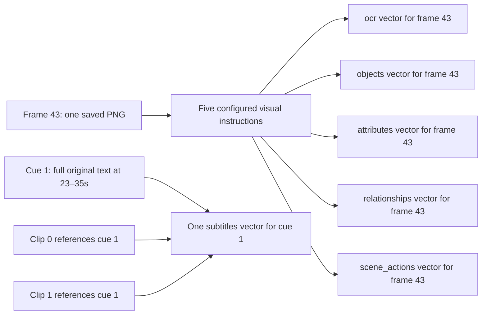

An OCR channel here is an **instruction-guided image embedding**. This step does not run a separate OCR engine and save recognized text. Likewise, `scene_actions` does not infer a full motion sequence from a single frame.

For our example:

```text
95 frames × 5 visual channels + 6 unique referenced cues = 481 vectors
```

“Unique cue” means unique cue ID. Two different cues with identical wording remain separate timed sources and receive separate vectors.

### Follow the coordinator first

[embed_prepared()][embed.embed_prepared] accepts:

- `evidence: PreparedEvidence`: which source items exist.
- `client: EmbeddingClient`: something providing the async `embed()` operation.
- `prompts: EmbeddingPrompts`: visual instructions and subtitle instructions.
- Output directory, request batch size, and storage chunk size.

It returns `EmbeddingCollection`, the **metadata describing the saved collection**. It does not return all vectors in one giant object.

```python
with embedding_writer(...) as writer:
    async with aclosing(iter_embedding_batches(...)) as batches:
        async for batch in batches:
            writer.append(batch)
    return writer.finish()
```

This is the important connection: the iterator makes a batch; the writer consumes it and saves it. The enclosing context makes sure temporary work is cleaned up if the operation fails or exits early.

### The embedding iterator, in actual order

| Call | Input → output | Responsibility |
| --- | --- | --- |
| [load_embedding_prompts()][embed.load_embedding_prompts] | TOML path → `EmbeddingPrompts` | Read the configurable visual perspectives and exact document/query instructions. |
| [iter_embedding_batches()][embed.iter_embedding_batches] | Evidence, client, prompts, request batch size → async stream of `EmbeddingBatch` | Coordinate all frame requests, then all subtitle requests. |
| [_frame_items()][embed._frame_items] | A batch of `VideoFrame` records and preparation ID → `EmbeddingItem` objects | Read the original image bytes into `Image` parts and attach IDs such as `PREPARATION:frame:43`. |
| [_embed_items()][embed._embed_items] | Items, channel, source IDs, exact instruction → one `EmbeddingBatch` | Construct `EmbeddingRequest(purpose="document")`, call the existing client, and wrap its result with source/channel information. |
| [_cue_items()][embed._cue_items] | Referenced cue batch and preparation ID → text `EmbeddingItem` objects | Send each complete cue as its own text item, with an ID such as `PREPARATION:cue:1`. |

The nested loops are important:

```text
For frame batch 0–15:
    embed under ocr
    embed under objects
    embed under attributes
    embed under relationships
    embed under scene_actions
For frame batch 16–31:
    repeat the configured visual channels
...
After all frame batches:
    embed referenced cues in subtitle batches
```

Image content is constructed once per frame batch and reused for its channel requests. Each channel still makes its own model request and inference. The current iterator awaits these requests sequentially; it does not launch five parallel HTTP calls.

### The data returned for a batch

An `EmbeddingBatch` connects the model's answer to the prepared evidence:

```text
EmbeddingBatch
  preparation_id: the preparation UUID
  channel: "objects"
  instruction: the exact objects indexing instruction
  source_ids: (32, 33, …, 47)
  result: EmbeddingResult
    embeddings: ordered EmbeddedItem objects
      id: "PREPARATION:frame:43"
      vector: 2048 floats in the current model configuration
    dimensions: 2048
    normalization: "l2"
    model_identity: requested ID and available returned ID/revision
    usage, request_id: when available
```

The instructions are parameters guiding representation. The returned vector represents the input under that instruction; the instruction is not stored as an extra independent source vector.

### How the writer turns batches into files

Read [embedding_writer()][store.embedding_writer], then [EmbeddingWriter.append()][store.EmbeddingWriter.append], then [finish()][store.EmbeddingWriter.finish].

| Component | What it does |
| --- | --- |
| `embedding_writer()` | Refuse an existing destination, determine expected IDs per channel, create a temporary sibling directory, construct the writer, and yield it. On exit, close the writer; the temporary-directory context removes unfinished work. |
| `EmbeddingWriter.__init__()` | Hold the preparation, prompts, expected source IDs, per-channel row counts, filenames, empty buffers, and eventual model specification. |
| `append(batch)` | Check that preparation, channel, instruction, source ordering, and model metadata agree. Convert returned vectors to CPU `float32`, copy rows into that channel's buffer, and flush full buffers. |
| `_flush(channel)` | Save that buffer's used IDs and vectors into a `.pt` file, flush the file, record its checksum and row count, then reuse the buffer. |
| `finish()` | Require all expected source rows, flush partial buffers, write `metadata.json`, rename the completed staging directory to the destination, and return collection metadata. |

The temporary workspace is not a second permanent copy. It prevents an incomplete collection from appearing at the final location as though indexing had succeeded.

The storage objects are:

- **`ModelSpec`**: model identity, vector dimensions, and normalization.
- **`ChunkInfo`**: channel, relative filename, row count, and SHA-256 checksum for one vector file.
- **`EmbeddingCollection`**: model specification plus collection/preparation/configuration IDs, full prompts, `float32` dtype, chunk size, and all chunk descriptions.
- **`_Buffer`**: temporary CPU ID tensor, vector matrix, and count of used rows for one channel. It is not a disk format.

At the default 4096 rows per chunk, our small example has one partial chunk per channel:

```text
prepared/
  manifest.json
  frames/
    frame_000000000.png
    ...
    frame_000000094.png
  embeddings/example-configuration/       # Caller chooses this destination name
    metadata.json
    visual/
      000/000000.pt                       # ocr: 95 rows
      001/000000.pt                       # objects: 95 rows
      002/000000.pt                       # attributes: 95 rows
      003/000000.pt                       # relationships: 95 rows
      004/000000.pt                       # scene_actions: 95 rows
    subtitles/000000.pt                   # 6 rows
```

The numeric visual folders map back to channel names through metadata. Arbitrary channel names are not used directly as filesystem paths.

Inside an image chunk:

```python
{
    "frame_ids": tensor([0, 1, ..., 94], dtype=torch.int64),
    "vectors": tensor_of_shape_95_by_2048_float32,
}
```

Inside a subtitle chunk, the key is `cue_ids` instead of `frame_ids`. Row 1's source ID need not equal 1 in every real collection; **the ID tensor gives the actual mapping**.

### Four different batch sizes that must not be confused

| Setting | Current default/location | What it controls |
| --- | --- | --- |
| `decode_batch_size` | 4 in `prepare_video()` | Frames requested together from the decoder. |
| `request_batch_size` | 16 in `embed_prepared()` | Input items sent together in one embedding HTTP request. |
| Server `batch_size` | 4 in `servers.toml` | Items processed together on the GPU inside that request. |
| `chunk_rows` | 4096 in the writer | Vector rows buffered for a storage file. |

A larger `.pt` chunk does not make the GPU infer 4096 images at once. These settings control different stages.

## 7. Reopening the saved material

Preparation and indexing can happen in an earlier process. The question phase reopens their output.

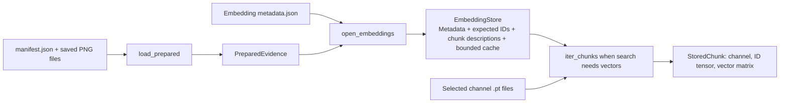

[load_prepared()][prepared.load_prepared] reads the manifest, restores image paths relative to the prepared directory, validates the result, and returns a `PreparedEvidence` object.

[validate_prepared()][prepared.validate_prepared] checks the source identities, sample records, fixed clip structure, references, and image properties. With `verify_images=True`, it also requests deeper image verification. The original source video and supplied SRT must still be available and match the recorded file identity. Preparation has not copied those original files into a self-contained archive.

[open_embeddings()][store.open_embeddings] constructs an [EmbeddingStore][store.EmbeddingStore]. Its constructor checks metadata, configuration identity, channel coverage, expected row counts, and expected chunk paths. It does **not** immediately load every vector matrix.

The store's `_entries` holds `(ChunkInfo, starting_source_offset)` pairs. It tells the reader which source IDs should appear in each chunk. It is not a list of loaded vectors.

When [iter_chunks()][store.EmbeddingStore.iter_chunks] is consumed:

1. Skip unselected channels.
2. Reuse a cached chunk if available.
3. Otherwise `_read()` checks its path and checksum, loads CPU tensors using `weights_only=True`, and verifies the IDs, dimensions, finite values, compact storage, and normalization.
4. Add it to the bounded cache when it fits, evicting least-recently-used chunks as needed.
5. Yield `StoredChunk(channel, ids, vectors)` to the caller.

`clear_cache()` discards cached tensor references. The default cache budget is 256 MiB. Setting it to zero disables retained chunk caching; search can still stream chunks.

For long videos, chunking avoids requiring all vector matrices in RAM at once. Search still performs a scan of selected vectors and retains source scores; it is not an approximate-nearest-neighbor database or a promise of constant-time search.

## 8. Entering the investigator

Our question is:

> Why did Leena replace the filter housing, and what tool did she use to remove it?

The entry point is [investigate()][coordinator.investigate] in `investigation/coordinator.py`.

### What the caller provides

| Argument | What the value contains or means |
| --- | --- |
| `question: str` | The exact original question. It remains the investigation's goal and first search query. |
| `evidence: PreparedEvidence` | All frame/cue/clip catalogs and source metadata. |
| `store: EmbeddingStore` | Access to the matching saved vectors and collection metadata. |
| `clients: ModelClients` | One VLM client and one embedding client. These are HTTP interfaces, not GPU models in core. |
| `run_directory: Path` | Where this question's notebook, events, reviews, and final outcome are saved. |
| `budget: RequestBudget` | Limits for each model request and evidence page. |
| `max_steps: int` | Maximum number of action steps in this notebook. |
| `outline_directory: Path` | Directory for reusable video outline cache files. |
| `outline_cache_identity: dict` | Caller-supplied identity of the outline-generating model/settings. It participates in the cache key; the caller must supply meaningful values. |
| `count_tokens` | Callable: `GenerationRequest → int`. It must count the complete input, including image tokens. |
| `general_instruction: str` | The embedding instruction used for general search queries. It is not the investigator's system prompt. |
| `max_searches` | Maximum **additional generated query variants**. The original is prepended, so the final plan can contain up to `1 + max_searches` queries. Default: 3 additional variants. |
| `top_k_per_query` | Maximum candidate clips returned for each initial query. Default: 5. |
| `rank_constant` | Constant used when merging rankings from the separate initial queries. Default: 60. |
| `limits: InvestigationLimits` | Total VLM call allowance, wall-time allowance, repeated-no-progress threshold, and attempts per retried decision/planning/review. |

### The first branch happens before any new model work

`_open_notebook()` checks that prepared evidence and vector collection belong together, then calls `open_notebook()`.

- **New directory:** create a new `NotebookState` and save `state.json`.
- **Existing running notebook for the same question and collection:** reload it and recover committed journal events missing from its snapshot. The investigator then rebuilds outline/planning/initial-search state.
- **Existing completed or incomplete notebook:** validate and return its saved `result.json`. A finished run directory does not silently start another run.
- **Mismatched question/preparation/collection:** raise an error. A notebook cannot be borrowed for different evidence.
- **Already at the step limit:** save an incomplete outcome immediately, before outline generation, planning, or searches.

For a new running investigation, the coordinator creates `_RunVLM`, which wraps the supplied VLM client to count attempts and enforce the run deadline. Every later VLM stage goes through this wrapper.

The coordinator also keeps some short-lived Python variables:

| Variable | What it holds |
| --- | --- |
| `outline` | The video's compact navigation summary and its sections. |
| `initial` | The initial plan, its search results, and merged clip queue. |
| `latest_result` | A small representation of the most recent tool result. |
| `latest_search` | The most recent successful follow-up `SearchResult`, kept even after later note/evidence actions. |
| `reader` | The object resolving source IDs and building original-evidence pages. |
| `last_review` | The latest answer proposal/review information, useful if a limit ends the run. |
| `seen`, `no_progress` | Content keys and a counter used to detect repeated actions without new material. |
| `pending_action`, `shown`, `reviewed_views` | Bookkeeping for an action in progress and evidence delivery, including interrupted review work. |

These variables are not all fields of `NotebookState`. That distinction matters for recovery later.

## 9. Getting the outline and planning the first searches

The model needs some idea of the video's terminology before choosing useful search wording. The outline provides this navigation help. It is not evidence that proves an answer.

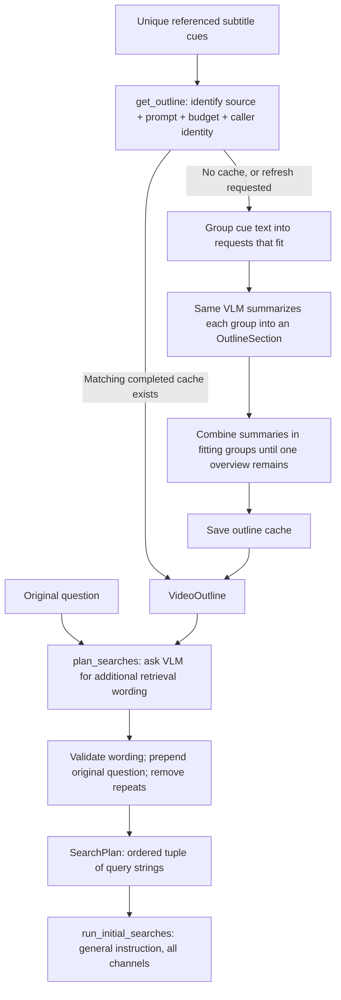

### Outline generation: follow these calls

| Function/class | Input → output | What it does |
| --- | --- | --- |
| [get_outline()][outline.get_outline] | Prepared evidence, VLM, cache settings, budget, token counter → `VideoOutline` | Load a matching cache or coordinate a complete outline build. |
| `_cache_location()` | Preparation ID, referenced cues, caller identity, budget → cache hash and JSON path | Include the outline prompt and source/settings in a stable recipe. |
| `_load_cached_outline()` | Path and expected IDs → outline or `None` | Reuse a completed matching cache. A malformed or mismatched existing cache is an error, not silently accepted. |
| [OutlineGenerator][outline.OutlineGenerator] | VLM, budget, counter, maximum calls → helper object | Keep the model interface, request-fit logic, call count, and model identity for this build. |
| `_build_sections()` | Ordered cues and generator → tuple of `OutlineSection` | Summarize fitting batches while retaining the original cue IDs and full source intervals. |
| `_build_overview()` | Sections and generator → one overview string | Repeatedly group and summarize existing summaries until one remains. |
| `_write_outline()` | Cache path and outline → saved JSON | Write a complete temporary file, then replace the cache path. |

Inside `OutlineGenerator`, `fits(text)` checks the text-character allowance and complete input-token count. `summarize(text)` checks its call allowance, sends the request, requires completed nonblank output, checks reported usage, and keeps model identity consistent.

The supporting functions explain how a large SRT is handled:

- `_cue_batches()` yields groups that fit. If one cue's text is too long for an outline request, it presents that cue in character slices.
- `_Piece(cue, start, end)` describes such a temporary display slice. `_render()` includes the original cue ID, original timestamps, character offsets, and exact slice text.
- `_request()` wraps outline text with `OUTLINE_PROMPT` in a `GenerationRequest`.
- `_text_batches()` groups generated summaries for the next reduction level.

**None of this changes the stored cue or its embedding.** Outline input paging is separate from cue storage and indexing. If a single cue is too long for the embedding server, the current embedding path rejects it; outline paging does not automatically fix that embedding request.

An outline object might contain:

```text
VideoOutline
  preparation_id, cache_id
  basis: "subtitles"
  overview: "Leena isolates a leaking filter, explains a cracked housing,
             removes it with a strap wrench, installs a replacement,
             and performs a short leak test."
  sections:
    OutlineSection(section_id=0, cue_ids=(0,1,2,3,4,5),
                   start_seconds=5.0, end_seconds=94.0, text="...")
  model_identity: the model that generated the outline
```

For this short invented video, one section might be enough. A long video's sections are **budget-based groups**, not necessarily 30-second clips. `section_id` and `clip_id` belong to different catalogs.

If there are no referenced subtitles, the result has `basis="unavailable"`, no sections, and a message saying no referenced subtitles are available. No visual overview is generated as a fallback.

### Planning: the VLM chooses wording, Python fixes the search policy

[plan_searches()][planning.plan_searches] receives the original question and `VideoOutline`. It asks the same VLM to generate additional questions or keyword phrases. At this stage the model does **not** choose channels or search style.

For example, its completed output might be:

```json
{
  "queries": [
    "cracked filter housing tightening cap cannot repair leak",
    "strap wrench remove water filter housing"
  ]
}
```

`plan_searches()` validates the result and returns:

```python
SearchPlan(
    queries=(
        "Why did Leena replace the filter housing, and what tool did she use to remove it?",
        "cracked filter housing tightening cap cannot repair leak",
        "strap wrench remove water filter housing",
    )
)
```

The original is always first. Deduplication ignores case and repeated whitespace. At least one distinct additional variant is required. `max_searches` limits the generated variants before the original is prepended.

`_build_request()` creates the prompt, payload, output allowance, and JSON Schema with query count/length limits. `_read_plan()` parses the returned text, tolerates a surrounding code fence, and validates the typed plan and configured limits.

On invalid/truncated output, planning can try again with feedback. A retryable endpoint failure can also be retried. Authentication, unsupported-capability, and other permanent errors are not fixed by asking the model again. Attempts are bounded.

## 10. Turning a query into ranked clips

### One query means one query vector

[run_initial_searches()][coordinator.run_initial_searches] takes the `SearchPlan` and calls [search_index()][search.search_index] once per query. Each initial request uses the general instruction and **all configured channels**.

For each query, the embedding model produces one vector. That same query vector is compared with saved vectors in every selected channel.

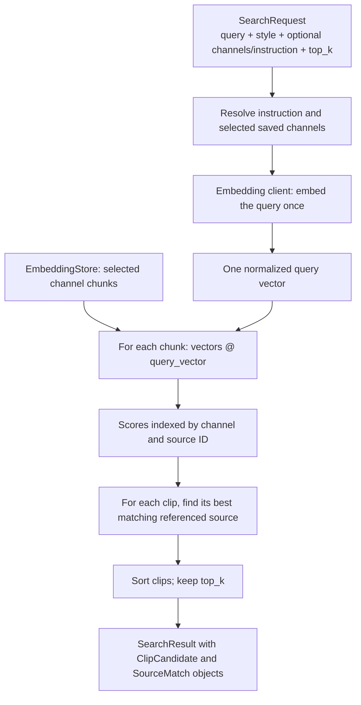

### Follow `search_index()` and its helpers

| In order | Function | Input → output |
| --- | --- | --- |
| 1 | `_select_channels()` | Optional requested names and saved prompts → selected channel names. `None` means all available channels; unknown names fail. |
| 2 | `_resolve_instruction()` | Request, saved prompts, general instruction → exact query instruction. A custom instruction overrides style; otherwise general/subtitles/visual style selects an instruction. |
| 3 | `_embed_query()` | Query text, instruction, client, saved metadata → one `EmbeddingResult`. It checks model compatibility, dimensions, and normalization against the saved collection. |
| 4 | `_score_chunks()` | Store, query tensor, selected channels → `dict[channel][source_id] = score`. It streams CPU chunks and performs matrix-vector multiplication. |
| 5 | `_rank_clips()` | Prepared clips, source scores, `top_k` → ranked `ClipCandidate` objects. |
| 6 | `_clip_score()` | One clip and source scores → its highest matching score, or `None` if nothing matched. |
| 7 | [_clip_matches()][search._clip_matches] | One selected clip, scores, frame/cue catalogs → sorted `SourceMatch` records with original times and channels. |

The result preserves `preparation_id`, `collection_id`, the original `SearchRequest`, the **resolved** instruction/channels, query model identity, and candidates.

### How matching cue 1 retrieves two clips

Suppose cue 1 gets a score of `0.82` for “cracked filter housing.” Both clip 0 and clip 1 reference that cue, so both can receive `0.82` from it. The cue vector is still stored once.

The matches identify why a clip was retrieved:

```text
ClipCandidate
  clip_id: 1
  start_seconds: 30.0; end_seconds: 60.0
  frame_ids: (30, …, 59); cue_ids: (1,2,3)
  score: 0.82
  matches:
    SourceMatch(channel="subtitles", source_kind="cue", source_id=1,
                start_seconds=23.0, end_seconds=35.0, score=0.82)
    ...other scored source/channel matches for this clip...
```

`_clip_matches()` supplies source descriptions and scores. It does not load a PNG into the VLM or prove that the answer is present. Opening the source is a later operation.

The clip score is a **maximum**, not a sum or average. A single high-scoring source can put a clip near the top. The current search does not calibrate scores across subtitle and image channels, and a similarity score is not an answer-confidence probability.

### Why there is a second ranking after initial searches

Separate query variants may rank the same clips differently. [_merge_clip_ids()][coordinator._merge_clip_ids] builds one unique clip queue using reciprocal rank fusion:

```text
Contribution from one query = 1 / (rank_constant + rank_in_that_query)
Merged score for a clip = sum of its contributions across queries
```

Rank starts at 1. With the default constant 60, first place contributes `1/61`, second contributes `1/62`, and third contributes `1/63`. A missing clip contributes zero for that query. A clip appearing in several result lists accumulates several contributions.

For example:

| Clip | Query 1 | Query 2 | Merged contribution |
| --- | --- | --- | --- |
| 1 | rank 1 | rank 1 | `1/61 + 1/61 ≈ 0.03279` |
| 0 | rank 2 | absent | `1/62 ≈ 0.01613` |
| 2 | absent | rank 2 | `1/62 ≈ 0.01613` |

Clip 1 comes first. Clips 0 and 2 tie, so the smaller clip ID comes first. The constant softens the difference between adjacent ranks; it is a configured ranking parameter, not a model-derived value.

This merging combines **query rankings**. It does not balance the visual/subtitle channels inside one search.

The output is `InitialSearchResult(plan, searches, clip_ids, rank_constant)`. It preserves each individual search and returns a deduplicated ordered queue. It does not automatically open every queued clip.

## 11. Building one model decision

Now the investigator has an outline, initial candidates, and a notebook. It needs to ask: **“Given what we currently know, what should happen next?”**

### What goes into the model request

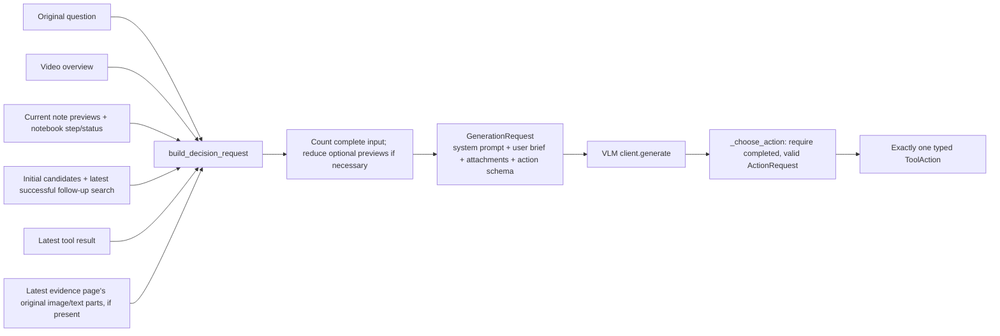

[_build_context()][coordinator._build_context] is the coordinator's wrapper. It extracts any latest evidence page, asks `reader.parts(page)` for actual image/text attachments, and calls [build_decision_request()][context.build_decision_request]. It returns `(request, shown)`: the model request and the evidence views attached to it. The loop reuses those views for delivery tracking instead of parsing the same page again after generation.

`build_decision_request()` assembles:

- The exact original question and compact video overview.
- Notebook status and step count.
- Selected working-note previews, their IDs, sources, status, and whether the text is complete.
- Query wording and candidate summaries, including clip windows and a few matching source IDs/scores.
- The latest tool result, including continuation cursor when applicable.
- Metadata about the latest successful follow-up search.
- The latest original-evidence attachments, when a read action has prepared a page.
- `DECISION_PROMPT`, which explains the job, the tools, and the distinction between navigation hints and evidence.
- `ActionRequest.model_json_schema()`, which describes valid output shapes.

It returns a `GenerationRequest`, the model-client package's common request object. The core does not build an HTTP response body here.

### What is deliberately small

Defaults are up to eight full candidate summaries, two source matches per query hit, five note previews, and 240 characters per note preview. Some extra candidate IDs can be listed without full summaries. These are presentation choices, not deletion from the underlying evidence or notebook.

`_candidate_summaries()` puts the latest follow-up candidates before the initial queue, deduplicates clip IDs, and records which query/rank produced each hit. `_note_summaries()` prioritizes active notes and recent updates.

If the complete request does not fit, the builder removes optional candidate summaries, then extra candidate IDs, then note previews. It reports omitted counts. It does **not** cut the original question or silently shorten the latest original-evidence text inside this builder. If the essential request still cannot fit, it raises `ContextBudgetError`.

Not all notes or past tool outputs are automatically sent on every turn. There is also no invisible persistent conversation inside the VLM server. The brief explicitly reconstructs the context for the next generation.

### What the model returns

For example:

```json
{"action":{"tool":"open_clip","clip_id":1,"cursor":null}}
```

[_choose_action()][coordinator._choose_action] calls the VLM, checks usage and completion, parses this with `ActionRequest.model_validate_json()`, and returns an `OpenClipAction` Python object.

If the response is truncated or invalid, `_action_attempt()` adds short correction feedback and tries again within `max_attempts`. It fits feedback by shortening the feedback itself, not by removing the original request. Transient endpoint failures can have a short retry delay. There is no deliberate delay between every successful action.

### What “tool calling” means in this implementation

The model sees tool descriptions and a JSON Schema. It outputs a JSON action. Python dispatches the resulting action object.

This is **application-managed structured actions**. The current clients do not send provider-native `tools` definitions or consume native `tool_calls`; the VLM client rejects unexpected native tool calls. The model still chooses which tool to request, but the mechanism is our schema and dispatcher.

The eight possible action types are:

| Action | What the model controls | What Python does with it |
| --- | --- | --- |
| `SearchAction` | Query, style, optional channels/instruction, `top_k` | Search the saved collection. |
| `OpenClipAction` | Clip ID and optional cursor | Prepare a page of that clip's frames and overlapping cues. |
| `OpenNeighborAction` | Anchor clip, previous/next, cursor | Resolve the adjacent fixed clip and prepare its page. |
| `ReadSourcesAction` | Specific frame/cue references, cursor | Prepare only those originals. |
| `ReadOutlineAction` | Optional section ID, cursor | Read navigation summaries. |
| `ReadNotebookAction` | Optional entry ID, cursor | Read current saved note previews or a full note page. |
| `WriteNotebookAction` | Note content, kind, sources, create/update ID, status | Validate the requested note; commit it when recording the step. |
| `RequestFinishAction` | Proposed answer, source references, declared gaps | Review the proposal before allowing completion. |

The available operations and their validation rules are fixed by code. Search wording, selected tools, note contents, and later search settings are model decisions. The coordinator is not a hardcoded sequence of “open clip 1, then clip 2, then answer.”

## 12. Opening original evidence and continuing through pages

### Opening a clip prepares a page; the next generation receives it

This timing is the most important part of the loop:

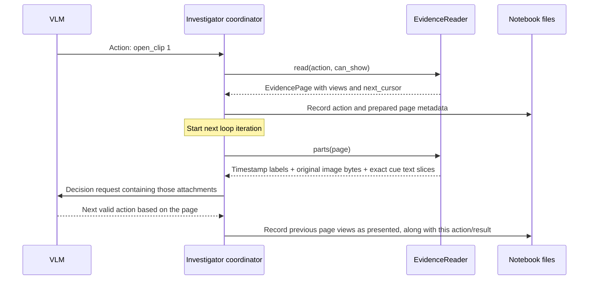

There is no extra callback from the VLM into a file reader. The coordinator supplies the prepared material in the **next request**.

### The two different objects

An [EvidencePage][types.EvidencePage] is a **description** of what to show:

```text
EvidencePage
  preparation_id
  tool: "open_clip"
  visual_window: (30.0, 60.0)
  views:
    EvidenceView(kind="cue", source_id=1, start=0, end=FULL_TEXT_LENGTH)
    EvidenceView(kind="frame", source_id=30, width=1920, height=1080)
    ...as many selected items as fit...
  notice: optional explanation
  next_cursor: opaque continuation string, or None
```

For text views, `start` and `end` are **character positions**, not seconds. For frames, width/height describe the original saved source image, and text offsets are zero.

`reader.parts(page)` creates the **actual content**:

```text
Text: visual window 30–60s; cue timing may extend outside the window
Text: Cue 1 [23s–35s]; characters [0:...] of ...
Text: "The housing has a crack, so tightening the cap will not fix the leak."
Text: Frame 30: actual 30s, requested 30s; source 1920×1080
Image: inline data URL containing that PNG's original bytes
...
```

The page metadata is small enough to log. The image bytes are loaded when building model content; they are not copied into every notebook event.

### Follow the reader's methods

| Method | Input → output | Job |
| --- | --- | --- |
| [EvidenceReader.__init__()][evidence.EvidenceReader.__init__] | Prepared evidence, outline, request budget → reader | Build ID lookup dictionaries for frames, cues, clips, and outline sections. Keep a cache for encoded images used in the current page. |
| [_select()][evidence.EvidenceReader._select] | Read action → ordered targets, optional visual window, notice | Resolve clip/neighbor/source/outline selection. Clip targets combine frames and cues in chronological order. |
| [read()][evidence.EvidenceReader.read] | Read action and `can_show(page)` callback → fitting `EvidencePage` | Apply continuation position, add fitting items, and return a cursor when material remains. |
| [parts()][evidence.EvidenceReader.parts] | Page → tuple of `Text` and `Image` parts | Attach source labels, timestamps, actual text slices, and original image bytes. |
| `_text()` | Text kind and ID → full original cue/outline/overview text | Resolve the text catalog before slicing a presentation. |
| `_image()` | Frame view → `Image` | Read/encode the PNG, reusing the current page's encoded image when possible. |
| [fully_presented()][evidence.EvidenceReader.fully_presented] | Accumulated views → complete frame/cue `SourceReference` objects | Count a frame when delivered, and a cue only after its full character range has been covered. |
| `page_result()` | Page → ordinary JSON-compatible tool result | Wrap the page with `tool` and `status="ok"`. |

The coordinator constructs `can_show` only for evidence-reading actions. Its `_page_fits()` function constructs the **whole upcoming decision request**, including the question, notes, schema-related request settings, labels, and image/text attachments, then counts its input. It does not merely count the page's subtitle characters.

### How paging works

Suppose clip 1 has 30 sampled frames, but the upcoming request can only fit a few images. `read()` returns the first fitting group and a `next_cursor`.

The model can request:

```json
{"action":{"tool":"open_clip","clip_id":1,"cursor":"RETURNED_CURSOR"}}
```

The real cursor binds the preparation, outline, read operation, target arguments, item index, and text offset. It is not an instruction to the model to invent an offset. Reusing it with a different clip/source request fails validation.

- More frames remain: return later frames on the next page.
- A cue's text is too long: present a character slice and retain the continuation. Preserve the cue's original ID and full time interval on every slice.
- One candidate text addition does not fit: shorten that presentation slice and test again.
- One whole image cannot fit even on an otherwise empty page: return a tool error. The reader does not resize that image or pretend it was seen.
- No neighboring clip exists: return an empty page with an explicit notice.

The core reader sends **the original saved image bytes**. The local VLM's processor still converts/preprocesses those images at its configured processing resolution. Original-byte delivery does not mean the neural network uses every original pixel unchanged.

### When evidence becomes eligible to support a note or answer

Retrieval lists and prepared pages do not automatically count as presented evidence. After a page is attached to a decision request and a valid next action comes back, its views enter the notebook's presented record when that step is committed.

The coordinator also includes this just-delivered page when validating the new action. It computes complete-source eligibility for observations, contradictions, and finish requests; other actions do not need that scan. Therefore the model can immediately write an observation about cue 1 after reading it; it does not need another empty turn merely to make the citation eligible.

For a long cue, `fully_presented()` merges delivered character ranges. Seeing only `[0:100]` of a 500-character cue is not enough to cite the complete cue for final completion. Outline and overview views never become original frame/cue evidence.

## 13. Saving progress in the notebook

The notebook has two related jobs: keep the model's selected working notes, and keep a reliable record of loop actions. Those are different kinds of information.

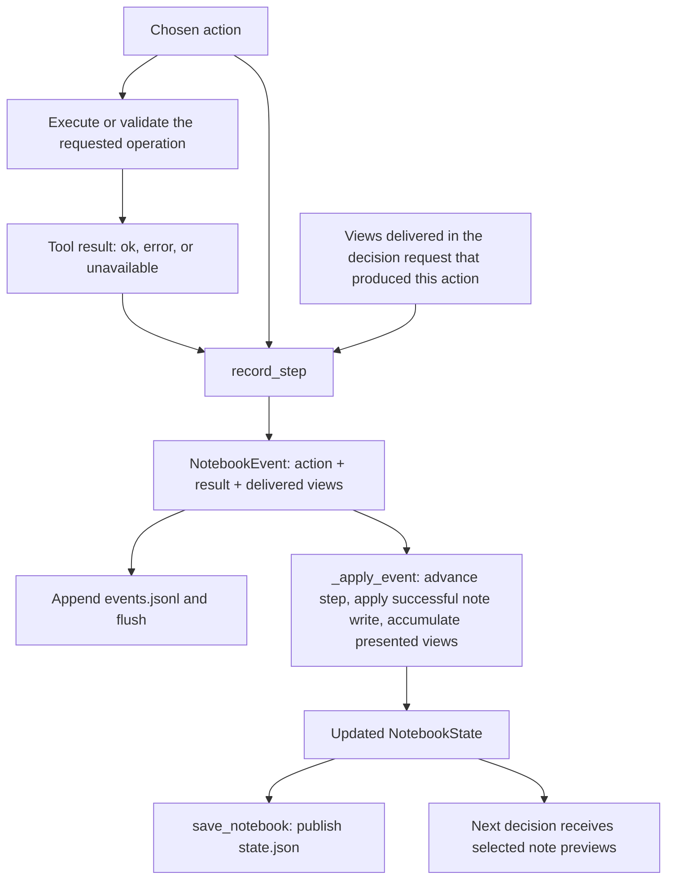

### Three objects to keep separate

| Object | What it holds | Who uses it |
| --- | --- | --- |
| [NotebookEntry][types.NotebookEntry] | One note: ID, kind, text, source references, active/resolved status, last updated step. | The model's working memory; context builder and notebook read tool. |
| [NotebookState][types.NotebookState] | Run/question/preparation/collection identity, running/completed/incomplete status, step count, current entries, accumulated presented views. | The coordinator and tools; saved in `state.json`. |
| [NotebookEvent][types.NotebookEvent] | One committed step: run ID, step number, typed action, JSON-compatible tool result, views delivered to the model. | The action journal and snapshot recovery; saved as one line in `events.jsonl`. |

For example, after inspecting cue 1, the model might choose:

```json
{
  "action": {
    "tool": "write_notebook",
    "entry_id": null,
    "kind": "observation",
    "text": "The housing is cracked; tightening the cap will not fix the leak. I still need to inspect the removal tool.",
    "sources": [{"source_kind":"cue","source_id":1}],
    "status": "active"
  }
}
```

The resulting `NotebookEntry` has an assigned ID such as 0 and an `updated_step`. Updating note 0 later replaces its current contents in `state.json`; the older write remains in the journal.

### Who actually writes the note?

[execute_tool()][tools.execute_tool] first validates the operation. For a note write, [_check_sources()][tools._check_sources] checks that references exist. Observations and contradictions must cite original sources that were completely presented. Plans and hypotheses may refer to existing sources that have not yet been inspected, because they are not verified findings.

`execute_tool()` returns a small success result describing the intended create/update. **It does not mutate the notebook itself.**

[record_step()][notebook.record_step] performs the commit:

1. Check that the saved state still equals the state the caller is using.
2. Construct the next `NotebookEvent`.
3. `_apply_event()` constructs and validates the updated state. A successful note write creates or updates its entry; other actions still advance the step and record delivered views.
4. Append and flush the event to `events.jsonl`.
5. `save_notebook()` rechecks identity/step validity and atomically writes `state.json` through `_write_state()`.
6. Return the new immutable `NotebookState` to the coordinator.

This is why the coordinator assigns `notebook = record_step(...)`. The function gives back the updated object; it does not secretly change the frozen object passed in.

### How the model sees previous progress

The next decision brief includes selected previews from the **current entries**. An omitted or incomplete preview can be followed with `ReadNotebookAction(entry_id=0)`. [read_notebook()][notebook.read_notebook] returns the requested note as paged text. With no entry ID, it lists note previews and lengths.

The notebook read cursor binds the run, current note revision, target entry/list, and character offset. If a note write changes that revision, an older cursor is no longer valid for the changed notebook.

The system does not automatically paste the entire journal into the prompt. It also does not currently offer a tool for reading arbitrary old journal events. The model must choose useful notes to keep, and can reread those current notes.

### What is and is not saved

- The journal records loop actions and their tool results, including errors. A follow-up search result includes its candidate/source matches.
- Evidence results log page **metadata**, not repeated image bytes or complete copied source files. Text and images are resolved from the prepared catalogs/files.
- Selected model-written findings live in current notebook entries. The application does not automatically turn every image inspection into a useful factual note.
- The initial search plan/results are kept in coordinator memory; they are not automatically separate notebook journal events. The outline is cached separately.
- Raw thinking text and every generation attempt are not saved as a complete chat transcript by the notebook. Review checks have their own journal.

### Recovery is about committed notes and events

`open_notebook()` calls `_recover_notebook()` when reopening an existing state. It replays committed events that were appended before a crash but not yet reflected in the snapshot. An incomplete trailing journal line is removed because it was never fully committed.

This recovers notebook consistency. It does **not** restore every coordinator local variable, evidence cursor, or partially completed review as a fully resumable agent execution.

## 14. Searching again and using the other actions

The model is not restricted to the initial wording. Once it sees the candidates and originals, it can choose a more targeted follow-up.

For our question, it might decide that subtitles explain the crack but the tool needs visual inspection:

```json
{
  "action": {
    "tool": "search",
    "query": "person holding a strap wrench around a water filter housing",
    "style": "objects",
    "channels": ["objects", "relationships"],
    "top_k": 3,
    "instruction": null
  }
}
```

### Follow-up search uses the same retrieval function

```text
_choose_action()
    → SearchAction
    → coordinator's search branch
    → execute_search()
    → SearchRequest
    → search_index()
    → SearchResult
    → record_step()
    → next decision brief
```

[execute_search()][tools.execute_search] checks notebook/evidence/collection scope, removes the `tool` field to construct a `SearchRequest`, and calls the existing `search_index()`.

Style and channels are independent:

| Request | What changes |
| --- | --- |
| General style, no channels specified | Embed the query using the general instruction; compare with all channels. |
| OCR style, no channels specified | Embed the query using the saved OCR query instruction; still compare with all channels. |
| OCR style, `channels=("ocr",)` | Use OCR wording guidance and compare only with OCR-channel saved vectors. |
| Custom `instruction` | Override the selected style's query instruction; selected channels still control which stored vectors are scanned. |

Each action still makes **one query vector**. Choosing two channels does not create two query vectors.

The coordinator replaces `latest_search` only on success. `_result_brief()` keeps the next prompt from duplicating the full serialized result; `build_decision_request()` uses the typed search object to provide candidate summaries and metadata. That latest successful search remains available through later evidence/note actions. A failed search becomes an error result; it does not destroy the previous successful search.

### Other actions in the same invented video

| Action example | What it does | Important branch |
| --- | --- | --- |
| `open_neighbor`, anchor clip 1, previous | Open clip 0 to see the earlier part of cue 1's visual context. | The anchor remains 1 when continuing this same read with its cursor. |
| `open_neighbor`, anchor clip 3, next | There is no clip after the last window. | Return an empty page and notice; do not invent a clip. |
| `read_sources`, frame 43 and cue 2 | Attach just the selected image and original subtitle text, subject to paging. | Unknown source IDs produce a tool error. |
| `read_outline`, no section ID | Read overview followed by outline sections, with continuation if needed. | These are navigation summaries, not eligible original citations. |
| `read_outline`, section 0 | Read that summary section. | Section IDs are not clip IDs. |
| `read_notebook`, entry 0 | Read the full saved observation or continue its text page. | A missing entry or stale cursor is an error. |
| `write_notebook`, entry 0, resolved | Replace note 0 with updated content/status. | There is no separate delete-note action. |

For evidence/notebook operations, `execute_tool()` converts expected `OSError`/`ValueError` failures into a JSON tool result with `status="error"`. The next decision can use that feedback. A valid supported action is selected before dispatch, so the fallback `status="unavailable"` is not the normal path for a known connected tool.

## 15. Proposing and reviewing an answer

A finish request is a **proposal**, not immediate completion.

Suppose the model has inspected cue 1, cue 2, and frame 43. It proposes:

```json
{
  "action": {
    "tool": "request_finish",
    "answer": "Leena replaced the housing because it was cracked, so tightening the cap would not repair the leak. She used a blue strap wrench to loosen and remove it.",
    "sources": [
      {"source_kind":"cue","source_id":1},
      {"source_kind":"cue","source_id":2},
      {"source_kind":"frame","source_id":43}
    ],
    "gaps": []
  }
}
```

### The review flow

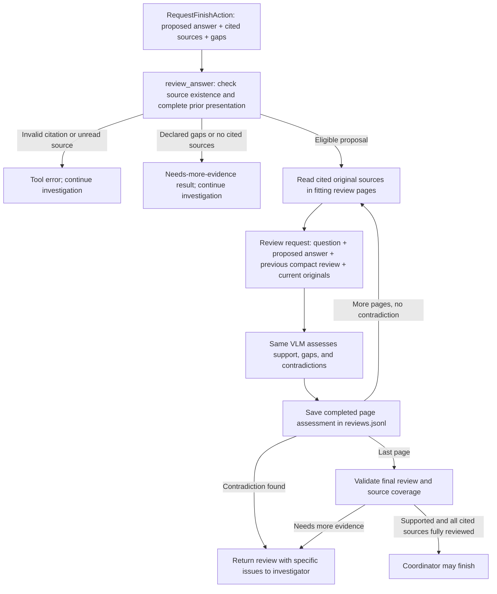

The reviewer is the **same model**, given a different job and fresh original evidence. This is a verification pass, not an independent second model.

### Inputs and outputs

[review_answer()][review.review_answer] takes the proposed action, current notebook, VLM interface, evidence reader, budget/counter, eligible presented sources, run directory, review ID, attempt limit, and an optional collector for completed review views.

It returns an ordinary tool-result dictionary. On a successful review operation, it contains the proposal, review ID, an [AnswerReview][types.AnswerReview], and reviewed/pending source references. The verdict can still say `needs_more_evidence`; `status="ok"` means the operation succeeded, not that the answer passed.

The coordinator merges returned review fields into its saved proposal information. Early citation errors therefore retain the proposed answer and review ID for an eventual incomplete outcome.

`AnswerReview` contains:

```text
verdict: "supported" or "needs_more_evidence"
summary: compact cumulative assessment, at most 1600 characters
sources: source references checked in this review
gaps: up to 8 short unresolved points
contradictions: up to 8 short conflicts with the proposed answer
```

Each gap/contradiction is at most 400 characters. A supported review must have sources and no reported gaps or contradictions. A needs-more-evidence review must explain an unresolved issue.

### The functions inside review

| Function | What it takes → what it returns | Responsibility |
| --- | --- | --- |
| `review_answer()` | Proposal and run components → tool-result dictionary | Validate eligibility, coordinate paging and assessment, track coverage, and preserve review progress. |
| `_page_fits()` in `review.py` | Proposed review page and review context → boolean | Count the actual review request, which differs from an investigator decision request. |
| `_review_request()` | Question, answer, previous assessment, page, reader, budget → `GenerationRequest` | Add `REVIEW_PROMPT`, current originals, and `AnswerReview` schema. |
| `_assess_page()` | Request, VLM, limits, set of sources shown in this review → `(AnswerReview, GenerationResult)` | Obtain a completed, valid assessment; reject invented review source IDs; retry bounded failures/invalid output. |
| `_record_review()` | JSON-compatible event → flushed line in `reviews.jsonl` | Preserve the started proposal and completed page checks with views, model identity, and usage. |
| `_review_error()` | Message → error tool result | Give the coordinator feedback without declaring support. |

Review reads the originals again even if they were already shown during investigation. That second read is deliberate: the model is now comparing a concrete proposed answer with its cited evidence.

For long evidence, only the current page and the previous compact assessment are sent. The code accumulates exact reviewed views separately and checks complete cited-source coverage. It does not ask the model to carry the entire image history in its prompt.

An intermediate supported verdict is provisional. The reader continues until all cited material is covered. A contradiction can stop the review early, returning the issue and any pending sources instead of spending more calls on an answer already known to conflict with evidence.

If a call fails or a run limit interrupts review, completed page assessments remain in `reviews.jsonl`. The code does not turn unread evidence into support. A later finish request starts a new review attempt; full automatic continuation from a previous review cursor is not implemented.

### What the review currently guarantees—and what it does not

Python checks source existence, prior complete presentation, schema validity, and complete rereading of the cited sources before a supported finish. The VLM judges whether claims are supported.

The review reads **the proposal's cited sources**. It does not automatically reread every earlier inspected source or every contradiction note. Its prompt checks factual claims, but the code does not independently prove that the answer covers every part of the original question. A plausible but incomplete answer can therefore be a testing concern.

For example, our question asks both **why** and **which tool**. A proposal answering only why might omit the tool without making a false claim. Testing must check that the model notices this omission. Likewise, evidence omitted from the citation list can contain a conflict that this review never sees. Do not interpret `completed` as a mathematical guarantee of truth or completeness.

## 16. Finishing and saving the outcome

The coordinator accepts completion only when the finish operation returns `status="ok"` and the review verdict is `supported`. It then exits the action loop and calls [_finish()][coordinator._finish]. Other endings also call `_finish()`, with an incomplete reason.

`_finish()`:

1. Parse any review into `AnswerReview` again at the outcome boundary.
2. Determine `completed` versus `incomplete` from the accepted review.
3. Resolve the review's cited frame/cue IDs back to original source timestamps.
4. Assemble the result dictionary.
5. Write `result.json` through a temporary file and atomic replacement.
6. Save notebook status as completed/incomplete.
7. Return the same outcome dictionary to the caller.

For our successful invented proposal, selected outcome fields look like this:

```json
{
  "question": "Why did Leena replace the filter housing, and what tool did she use to remove it?",
  "status": "completed",
  "answer": "Leena replaced the housing because it was cracked, so tightening the cap would not repair the leak. She used a blue strap wrench to loosen and remove it.",
  "proposed_answer": null,
  "sources": [
    {"source_kind":"cue","source_id":1,"start_seconds":23.0,"end_seconds":35.0},
    {"source_kind":"cue","source_id":2,"start_seconds":35.0,"end_seconds":49.0},
    {"source_kind":"frame","source_id":43,"start_seconds":43.0,"end_seconds":43.03333333333333}
  ],
  "gaps": [],
  "reason": "Answer supported by reviewed evidence."
}
```

The actual result also includes run/preparation/collection IDs, the review object and ID, pending sources when available, action step count, VLM call count, and elapsed seconds. The exact source list is the review's source list; Python does not independently assign each sentence its own citation.

An incomplete outcome uses `answer=null`, can preserve a `proposed_answer`, and explains the stop reason and known gaps. The code gathers review gaps/conflicts, declared proposal gaps, and active question/contradiction notes for that incomplete result.

For a supported completion, current `_finish()` clears the result's gaps. Active contradiction notes elsewhere in the notebook are **not an independent completion veto**. This is a current limit to understand when reading the code and designing tests.

The final public result is currently a `dict[str, JsonValue]`, called `Record` inside the coordinator. There is no separate typed `InvestigationResult` contract at this point.

## 17. One possible investigation from question to answer

This sequence uses the invented video throughout. Page sizes, search rankings, and actions are illustrative; the model may choose a different valid order.

| Stage | Main functions | Input/state | Result and what happens next |
| --- | --- | --- | --- |
| Enter | `investigate()` → `_open_notebook()` | Our original question, prepared filter video, saved collection, clients/settings | New running notebook with zero actions. |
| Orient | `get_outline()` | Six complete referenced cues | Overview identifies isolation, damaged housing, removal, replacement, test. Reuse cache if it already matches. |
| Plan | `plan_searches()` | Original question and overview | Original question plus two useful variants. |
| Find candidates | `run_initial_searches()` → `search_index()` | Each query uses general instruction and all channels | Candidate queue might start `(1, 0, 2)`. Shared cue 1 can retrieve both clips 0 and 1. |
| Action 1 | `_build_context()` → `_choose_action()` → `execute_tool()` | Candidate windows and source hints | Model asks to open clip 1. Reader prepares its first page; event records the prepared page metadata. |
| Action 2 | Context builder attaches page; model chooses next action | Original cue 1 and whichever images fit | Model writes observation note 0 about the crack. This step records the delivered page views and the note. |
| Action 3 | `_choose_action()` → `execute_search()` | Model still needs the removal tool | Objects/relationships search finds candidate images near the tool. Latest successful search is retained. |
| Action 4 | `execute_tool()` → `EvidenceReader.read()` | Match references include frame 43 | Model requests frame 43 and cue 2 using `read_sources`. A fitting page is prepared. |
| Action 5 | Model receives those originals | Image shows a blue strap wrench; cue 2 names the tool | Model writes observation note 1 citing frame 43 and cue 2. |
| Optional continuation | Reading action with returned cursor | If a needed cue/image was not in the previous page | Read the remaining material before citing it as completely presented. |
| Finish proposal | `_choose_action()` → `RequestFinishAction` | The two findings and complete eligible citations | Model proposes the combined answer with cue 1, cue 2, and frame 43. |
| Review | `review_answer()` → reader → `_assess_page()` | Proposed answer and cited originals | Same VLM checks the claims; Python tracks complete review coverage. More review pages are automatic within this finish action. |
| Publish | `_finish()` | Accepted supported review | Save completed result with original timestamps; mark notebook completed; return result to caller. |

If a review instead says “the color is unclear,” the investigator receives that specific gap. It can open another saved image, search under attributes, revise the unsupported wording, or state the gap. If the evidence never supports completion before a limit, the system saves an incomplete outcome.

You can follow this whole question path by starting at `investigate()`, then opening only the function named in each row. You do not need to read all server internals before understanding the investigation.

## 18. The model clients and local servers

The previous sections treated `client.embed(request)` and `vlm.generate(request)` as operations. Here is what those operations connect to.

### Common request/response objects

| Type | Contents | Used by |
| --- | --- | --- |
| `Text` | One text string. | Both model interfaces. |
| `Image` | An HTTP(S) URL or inline base64 image data URL. Current local servers require inline images. | Image embeddings and VLM evidence requests. |
| `Message` | Role (`system`, `user`, `assistant`) plus a tuple of text/image parts. | VLM requests. |
| `GenerationRequest` | Messages, optional JSON Schema, output allowance, optional temperature and timeout. | Outline, planning, decisions, review. |
| `GenerationResult` | Completion status, output text, optional parsed JSON/refusal, finish reason, model identity, usage, request ID. | The core decides whether to accept/retry an output. |
| `EmbeddingItem` | Application ID plus text/image parts. | Indexing sources or one search query. |
| `EmbeddingRequest` | Ordered items, document/query purpose, optional instruction/dimensions/timeout. | Embedding client. |
| `EmbeddedItem` | Original application ID plus a tuple of vector floats. | Vector writer and query search. |
| `EmbeddingResult` | Ordered embedded items, dimensions, normalization, model identity, usage/request ID. | Indexing and retrieval. |
| `ModelIdentity` | Requested model ID and returned model/revision when available. | Saved provenance and model compatibility checks. |
| `Usage` | Input/output/total token counts, each optional if an endpoint does not supply it. | Accounting and checks. |

These contracts are strict, frozen Pydantic models. In plain terms: fields have defined types, unknown fields are rejected, non-finite numeric values are not accepted, and normal attribute reassignment is prevented. This helps detect a broken handoff close to the boundary where it occurs.

`VLMClient` and `EmbeddingClient` are protocols: they describe the methods the core expects. They do not themselves load a model. `ModelClients` is a small frozen dataclass holding implementations of those two interfaces.

### Configuration and client lifetime

[load_profiles()][client_config.load_profiles] reads `config/models.toml` into `ModelProfiles(vlm, embeddings)`. Each profile holds endpoint/model/timeout information and capability/format choices.

[create_model_clients()][factory.create_model_clients] resolves configured API key environment variables, constructs two SDK clients, wraps them in the compatible VLM/embedding classes, and yields one `ModelClients` object.

```python
async with create_model_clients(profiles) as clients:
    result = await clients.vlm.generate(request)
# HTTP clients have been closed here; separate model servers can still be running.
```

The decorator makes the function usable with `async with`. `yield` hands the clients to the caller while the context is open. `AsyncExitStack` retains the cleanup operations; leaving the block resumes cleanup and closes both SDK clients, including when an exception occurs. `_api_key()` supplies an explicit local placeholder when no key variable is configured. `_sdk()` constructs the connection client with SDK automatic retries disabled, so core retry policies do not accidentally multiply hidden retries.

The three configuration files control different things:

| File | Controls | Does not control |
| --- | --- | --- |
| `config/models.toml` | Where the application sends requests, model names, client capabilities, timeouts, wire format. | Whether a server process is running or how much GPU memory its weights occupy. |
| `config/servers.toml` | Local model loading, device/dtype, preprocessing resolution, inference settings, thinking and server ceilings. | Which evidence the investigator chooses to read. |
| `config/embedding_prompts.toml` | Visual channel list and exact indexing/query instructions; subtitle instructions. | The actual question or investigator action sequence. |

These files are not automatically synchronized by HTTP. The caller's token counter and budgets should agree with the server's actual processor/settings. Changing an embedding model or document instruction requires a compatible new collection; an unrelated embedding model cannot safely search old vectors just because dimensions match.

### Run the workspace and services

The workspace requires Python 3.13 or newer. The checked-in UV configuration selects CUDA 13.0 builds of Torch/TorchCodec. Current local inference runtimes require CUDA; preparation also uses CUDA video decoding and needs `ffprobe` on the executable path. Source video/SRT files are caller-supplied; the system does not download a video or generate its subtitles.

Run from the repository root:

```bash
uv sync --all-packages --locked
```

Start each required service in its own terminal:

```bash
uv run --package video-mammoth-embedding-server uvicorn video_mammoth_embedding_server.app:create_app --factory --host 127.0.0.1 --port 8001
```

```bash
uv run --package video-mammoth-vlm-server uvicorn video_mammoth_vlm_server.app:create_app --factory --host 127.0.0.1 --port 8002
```

`GET /health` on each port reports its model and loaded settings. The VLM health response additionally reports busy/ready and JSON Schema support. The embedding health response reports ready; its inference lock serializes requests rather than exposing a busy health state. These are inference endpoints, not job status endpoints for preparation or investigations.

Server settings are selected in this order: explicit `create_app(config_path=...)`, then `VIDEO_MAMMOTH_SERVER_CONFIG`, then the workspace's `config/servers.toml`. Each service reads its own TOML section at startup. Restart that service to load changed settings. Client profiles and embedding prompts are loaded when their explicit loader functions are called; editing those files does not mutate existing objects.

Current **TOML values** are listed below. They are configuration choices, not architectural constants; class defaults can differ when a different settings file omits a field.

| Boundary | Current configuration |
| --- | --- |
| VLM client | `http://127.0.0.1:8002/v1`, `Qwen/Qwen3.5-2B`, 120-second request timeout, images/schema/temperature supported. |
| Embedding client | `http://127.0.0.1:8001/v1`, `Qwen/Qwen3-VL-Embedding-2B`, 90-second timeout, multimodal `content` input, explicit `instruction`, symmetric purpose mode, expected 2048 dimensions, L2 normalization. |
| VLM runtime | CUDA, auto dtype, SDPA, cached model files required; 8192 context tokens, 32 images and 64 messages maximum, 65,536–262,144 image preprocessing pixels. |
| VLM generation | Thinking enabled, up to 2048 thinking tokens, at least 256 final-answer tokens reserved, default total output 768, ceiling 4096; temperature 1.0, `top_p=0.95`, `top_k=20`. |
| Embedding runtime | CUDA, auto dtype, SDPA, model downloads allowed if absent; GPU batch 4, at most 64 request items, 8192 input tokens per item, 4096–1,048,576 preprocessing pixels. |
| Embedding perspectives | `ocr`, `objects`, `attributes`, `relationships`, `scene_actions`, plus subtitle cue indexing/query instructions. |

Neither current local client profile names an API key environment variable. For an external endpoint, `api_key_env` selects the variable to resolve. The factory does not automatically read a `.env` file: the caller or launcher must make variables available in the environment. Do not put keys into saved prompts, notebooks, or committed configuration.

The caller must also choose the per-request `RequestBudget`, `max_steps`, run/output paths, `general_instruction`, token counter, and outline cache identity. These are not automatically read from `models.toml` by `investigate()`. For a local VLM, build the counter from the same loaded server settings. Supply model/revision and relevant inference settings in `outline_cache_identity`; the cache key cannot infer settings the caller leaves out.

### The embedding client path

```text
EmbeddingRequest
  → OpenAICompatibleEmbeddings.embed()
  → _request_options() and _inputs()
  → POST /v1/embeddings
  → provider JSON response
  → _result(): reorder by input index, validate, normalize, restore IDs
  → EmbeddingResult
```

- `_request_options()` maps instruction/dimensions/purpose when the profile supports those fields.
- `_inputs()` selects plain text input or multimodal `content` items. The current local Qwen profile uses `content`.
- `_vector()` performs robust L2 normalization when configured: divide by the largest absolute component before computing length, then divide by that scaled length. The direction remains the same while the final vector has unit length.
- `_result()` rejects missing/duplicate output indices, wrong dimensions, and inconsistent vectors. It reattaches the application's IDs and calls `validate_for()` to confirm order matches the request.

For current Qwen settings, `purpose_mode="symmetric"` means the client does not add an `input_type` field. It does **not** mean query and document instructions must be identical. The explicit `instruction` is still sent because `instruction_field="instruction"` is configured.

Named search styles use the query instructions stored in the opened collection's `metadata.prompts`; search does not reload `embedding_prompts.toml`. Editing that file alone does not change the recipe of an existing collection. A custom `SearchRequest.instruction` overrides the named style for that query without rewriting document vectors.

With a provider that expects `input_type`, that mode maps purpose to `search_query` or `search_document`. This is endpoint format adaptation. The current local server accepts both values but uses the same Qwen prompt path, with the supplied instruction controlling the specific representation.

### The VLM client path

```text
GenerationRequest
  → OpenAICompatibleVLM.generate()
  → _request_options() + messages_to_api()
  → POST /v1/chat/completions
  → provider JSON response
  → _result(): normalize completion status, validate JSON if requested
  → GenerationResult
```

`_request_options()` selects the configured token-limit field, temperature if supported, and strict `response_format` when a JSON Schema is present. `_result()` maps `stop` to completed and `length` to truncated; it also handles refusal/unknown outcomes. For a completed structured response it validates JSON against the supplied schema and includes `ParsedJSON`.

The core still parses the expected domain object, such as `ActionRequest` or `AnswerReview`, from result text. A syntactically valid provider response and a semantically eligible action are separate checks.

Both clients parse provider JSON with duplicate-key/nonstandard-number rejection, translate HTTP/connection/timeout failures into `ModelClientError`, and preserve useful safe metadata. `_Provider...` classes describe incoming provider response shapes; they are not extra business-domain objects passed through the core.

### Content helpers

[image_from_file()][content.image_from_file] validates supported still-image bytes and produces an inline data URL. It does not resize the source. `_image_media_type()` checks format, size, dimensions, and decodability; `_check_inline_image()` checks existing inline data. `parts_to_api()` maps `Text`/`Image` to wire content, and `messages_to_api()` maps message roles/content while enforcing image-capability rules.

Client support for a format is broader than any one local endpoint. For example, the common `Image` object can contain a remote URL, but both current local runtimes require inline image data. A different endpoint may support remote URLs.

### How a server starts and remains loaded

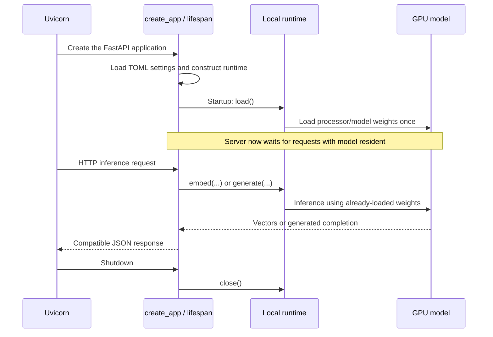

The two `create_app()` functions follow this lifetime separately. Their inner `lifespan()` functions load on startup and close on shutdown. Local `load_settings()` functions read the matching server section, using an explicit path, the `VIDEO_MAMMOTH_SERVER_CONFIG` override, or the default workspace file.

**Embedding server:** `EmbeddingPayload` validates the request. The endpoint checks the model name and serializes inference with a lock. `EmbeddingRuntime.embed()` validates inputs and splits HTTP items into GPU batches. `_model_input()` constructs text/image inputs; `_decode_image()` loads image pixels; `_embed_batch()` preprocesses without silent text truncation, runs the resident model, checks vector shape/values, normalizes, and returns CPU float lists.

**VLM server:** `ChatPayload`, `ChatMessage`, and content-part wire models validate the HTTP request. The endpoint rejects a second inference request as busy rather than performing overlapping GPU generation. `VLMRuntime._messages()` decodes inline images and constructs the processor conversation. `generate()` applies the chat template, checks context/output limits, generates, removes native thinking from the public answer text, and returns `Completion(text, finish_reason, input_tokens, output_tokens)`.

Both runtimes select inference dtype from settings, require CUDA, and release model references in `close()`. Resident model dtype and saved embedding `float32` are separate choices: mixed-precision inference can still produce vectors saved as CPU float32.

### Thinking and structured JSON

The current server TOML enables thinking. Its maximum thinking allowance is 2048 tokens, minimum answer reservation is 256 tokens, and maximum request output ceiling is 4096 tokens. A caller's smaller output request still takes precedence over that ceiling.

With current thinking settings, requests below 258 output tokens are rejected: the runtime requires space for the answer reserve plus thinking/closing overhead. A 768-token request does not gain a separate 2048-token thinking allowance. Both thinking and the final answer must fit inside that request's 768-token total; a larger allowance must be requested explicitly, within the server ceiling and full context budget.

`_ThinkingBudget` ends the thinking phase when its allowance is reached, while reserving answer space. Thinking may also finish naturally earlier. Total output usage counts generated thinking and final-answer tokens together; the response text contains only the final answer portion.

For structured requests, `JSONDecoder` builds reusable tokenizer lookup data. `constrain()` creates a schema parser and `_JSONConstraint` for this generation. During the answer phase, `_JSONConstraint.__call__()` keeps model scores only for tokens allowed by the current JSON prefix/schema and sets all other scores to negative infinity. Hugging Face generation then chooses from the remaining allowed tokens. It does not call the model a second time merely because an invalid token scored highly.

JSON constraints wait until thinking has ended. EOS is allowed only after a complete JSON value is possible; the finished text is validated again. Schema enforcement controls structure, not factual truth, useful search wording, or whether a chosen action will succeed.

### Token counting without loading a second VLM

[LocalTokenCounter][counting.LocalTokenCounter] loads the local processor, not model weights. Its `__call__(GenerationRequest)` uses the same chat template, thinking setting, and image-processing size to count full input tokens. This includes processed image tokens, which a text-only tokenizer count would miss.

The caller supplies this counter to core. It is not a hidden hardcoded dependency of `investigate()` on this particular local VLM server. A different provider needs a suitable counter and compatible capability/settings choices. Changing only a URL works only when the new endpoint actually supports the expected wire format and requested features; multimodal embedding extensions are not universal.

## 19. Budgets, limits, errors, and recovery

### A clip and a request are different sizes

Thirty seconds is an evidence organization rule. It is not a guarantee that all frames, subtitles, prompt text, and output space fit one model request.

[RequestBudget][types.RequestBudget] contains:

| Field | Meaning |
| --- | --- |
| `max_frames` | Maximum image count in an evidence page. |
| `max_pixels_per_frame` | Raw-frame limit used by the standalone raw budget checker. The evidence reader does not resize images or use this as a processing-resolution setting. |
| `max_subtitle_chars` | Character allowance for evidence text pages and outline source grouping. It is not a replacement for token counting. |
| `context_window_tokens` | Total context allowance chosen by the caller. |
| `max_output_tokens` | Reserved generation allowance for the request. |
| `safety_tokens` | Additional space left unused to reduce counting/settings mismatch risk. |
| `max_input_tokens` | Computed: context minus output minus safety. |

For example, `8192 - 4096 - 256 = 3840` input tokens. These numbers illustrate a caller budget; they are not a fixed global budget automatically installed by the coordinator.

`input_tokens_fit()` compares an assembled count with that input allowance. `check_request_budget()` is a standalone validator for raw frame/cue lists and token totals; planning uses it with no raw evidence. The normal evidence reader instead limits page counts/characters and checks the full upcoming request.

`TokenCounterCache` remembers **one exact last request and its count**. It avoids repeated processing when the reader's fit check and immediate generation request are identical. Changed content is recounted; it is not a cache of the whole investigation history.

### Three different ways to stay within context

| Material | What the code does when it is large |
| --- | --- |
| Original images/cue text | Page through material with explicit continuation; keep full originals on disk. A single image that cannot fit is an error. |
| Candidate/note previews | Omit optional previews and report omitted counts. Current note contents and source catalogs are retained. |
| Subtitle-based outline | Summarize fitting source groups, then combine summaries hierarchically. This is lossy navigation summarization, not a copy of every fact. |

More action steps can let the model read more evidence pages. They cannot make an oversized essential prompt or one unfit image fit a single request. Also, the model has to request ordinary evidence continuations; Python does not automatically read every remaining clip page. Review paging is automatic within the finish action.

### Run limits are separate from per-request budgets

`InvestigationLimits` defaults are 128 VLM calls, 3600 seconds, 8 consecutive no-progress steps, and 2 attempts for retried planning/decision/review operations. `max_steps` is provided separately to `investigate()`.

- A **step** is one selected tool action plus its recorded result.
- A **VLM call** is an actual generation attempt, including outline/planning, invalid-output retries, decisions, and review page assessments.
- An **embedding call** is not included in `max_model_calls`, but awaited search time falls within the investigation's overall timeout.
- One finish step can make several review calls, so step count alone would not bound generation cost.

`_RunVLM.generate()` checks remaining time/calls, increments call count, applies a timeout bounded by the remaining run time, delegates to the real client, and checks time again. The outer `asyncio.timeout` also bounds awaited work. Synchronous disk/CPU operations are not forcibly interrupted in the middle like a separate process would be.

`_progress_keys()` recognizes new source views, candidate/source IDs, distinct note content/status, and notebook text pages. Repeated score changes or note-update timestamps alone do not count as progress. This is a practical repetition heuristic, not a proof that a new note is meaningful.

### Important branches to recognize in the code

| Situation | Current behavior |
| --- | --- |
| No subtitle file | Visual index still works; outline reports unavailable; no subtitle vectors. |
| No matching candidates | Empty candidates are valid; the model can reword a query or choose another valid read/action. |
| Unknown style/channel/clip/source | Reject or return a tool error at the appropriate boundary. Do not create an ID or silently change the request. |
| Partial cue presentation | Keep cursor/character range; complete-cue eligibility waits for full coverage. |
| Truncated/invalid action JSON | Retry within the attempt allowance with correction feedback. |
| Authentication/capability failure | Treat as permanent rather than blindly repeating the request. |
| Review reports gaps/conflict | Return feedback to the investigation loop; no supported completion. |
| Review interrupted | Preserve completed review-page events and identify pending sources when available. |
| Step/call/time/no-progress allowance reached | Save an incomplete outcome, with a proposal/review if available. |
| Finished run directory reused | Return its saved outcome after identity checks. Use a new directory for a new attempt. |
| Snapshot lags committed notebook journal | Replay committed events through `_recover_notebook()`. |
| Invalid input/configuration or failed durable file operation | Some errors propagate to the caller. There is no blanket guarantee that every possible exception becomes an incomplete result. |

Prepared/embedding/outline identities prevent accidental cross-use of unrelated artifacts. They do not provide a multi-user database transaction system. The notebook uses guarded saves; the current coordinator is intended to own one run's writes.

An elapsed-time timeout can stop the caller while steps or VLM-call allowance remain. It does not shut down the model servers, and cancelling an HTTP wait does not guarantee immediate cancellation of generation already running in the separate server process.

## 20. What is saved, and what remains to test

Here is an illustrative directory arrangement. Callers choose directory names; core writes the named artifact files within them. The current checkout starts without generated indexes or notebook/run data; these files will be created by new preparation, indexing, and investigation calls.

```text
memory/filter-example/
  prepared/
    manifest.json                   # Video/frame/cue/clip catalogs and preparation settings
    frames/*.png                    # Saved original sampled images
    embeddings/example-configuration/
      metadata.json                 # Collection identity, model specification, prompts, chunks
      visual/000/*.pt                # IDs and vectors for configured visual channel 0
      visual/001/*.pt
      ...
      subtitles/*.pt                # Cue IDs and cue vectors, when cues exist
    overview/
      CACHE_HASH.json               # VideoOutline; directory chosen by caller
  runs/question-001/
    state.json                      # Current NotebookState
    events.jsonl                    # Committed action/result journal
    reviews.jsonl                   # Actual review-attempt/page events, when review occurred
    result.json                     # Completed or incomplete final outcome
```

The manifest stores relative frame paths, but source video/SRT identities retain their resolved paths, sizes, and modification times. Those identities are file-stat checks, not source-content hashes. Original input files are not copied into the preparation. Each vector chunk separately has a SHA-256 checksum in collection metadata and contains an `int64` `frame_ids` or `cue_ids` tensor plus a `float32` `vectors` matrix; source text, paths, and times remain in the preparation catalog.

Source media, `data/`, `memory/`, `runs/`, model weights, vector files, environments, caches, and credentials are ignored by Git. Source code, TOML settings, `pyproject.toml`, `uv.lock`, and this document are tracked. Preparation and embedding publication require new output directories; they do not silently overwrite a collection. A caller selects paths rather than relying on one hardcoded video folder.

### What the implementation currently makes possible

A caller can prepare a local video and optional SRT, index configurable image perspectives plus unique referenced cues, reload that collection, search it, and run the model-directed investigation through notes, evidence reads, further searches, answer review, and a saved outcome.

This is enough infrastructure to write a **small full-path test caller before implementing application API/CLI/UI**. A successful search or isolated tool test does not by itself verify that the model makes useful choices through the entire loop. That full live-model behavior still needs testing.

### Limits to keep visible while testing

- Cited-source review is not a sweep of all earlier evidence. An uncited contradictory observation can be missed, and active contradiction notes do not independently block `_finish()`.
- Review checks claims/support but does not separately enforce coverage of every requested question part. Test partial answers to multi-part questions, such as our reason-plus-tool example.
- There is no per-claim citation object; the answer has one shared source list.
- Evidence/notebook continuations are available, but there is no durable model-managed pending-work queue that automatically resurfaces every unread cursor.
- The current notebook tool reads current notes, not arbitrary earlier journal events. Useful long-term investigation memory depends on the notes the model chooses to save.
- Notebook journal recovery is implemented. Full coordinator/review/indexing resume is not.
- Search scans selected vector chunks on CPU and retains score dictionaries. Chunking bounds loaded tensor caching; it does not by itself prove speed or total memory use for 10-hour videos. Full long-video benchmarking is still needed.
- There are no lexical transcript search, search time-range filters/pagination, channel-balanced ranking, or dynamic interval resampling tools in this rewrite.
- Evidence uses saved still frames and supplied subtitles. There is no audio understanding, automatic speech transcription, or native video playback tool here.
- API, CLI, web integration, and a maintained test suite are not implemented in their placeholder directories.

These points describe the code's present boundaries. They do not change the main function flow above or require copying the old implementation's architecture.

## 21. A map of the data types

Use this as a reference after following the execution. The types are grouped by the handoff they describe, so “what is inside this argument?” has a quick answer.

### Preparation and indexing types

| Type | Contains | Passed between |
| --- | --- | --- |
| [VideoInfo][types.VideoInfo] | Source path/stream, duration, dimensions, timestamp origins, optional FPS/codec. | Probe → preparation/sampler. |
| [SourceFile][types.SourceFile] | Original file path, size, modification time. | Preparation → manifest validation/reload. |
| [VideoFrame][types.VideoFrame] | Frame ID, source video/stream, PNG path, requested/actual time, source-frame duration, dimensions. | Sampler → prepared catalog → embeddings/reader/search timestamps. |
| [SubtitleCue][types.SubtitleCue] | Cue ID, full text, original start/end. | SRT reader → clip plan, indexer, outline, reader. |
| [Segment][types.Segment] | Clip ID, fixed start/end, overlapping cue IDs. | Segment planner → prepared clip construction. |
| [PreparedClip][types.PreparedClip] | All `Segment` fields plus sampled frame IDs. | Preparation → search and evidence tools. |
| [PreparedEvidence][types.PreparedEvidence] | Identity, video/source metadata, requested times, preparation settings, full frame/cue/clip catalogs. | Preparation/storage → all later core work. |
| [VisualPrompt][types.VisualPrompt] | Channel name, indexing instruction, query instruction. | Prompt config → indexer and search. |
| [EmbeddingPrompts][types.EmbeddingPrompts] | Configured visual prompts and subtitle indexing/query instructions. | Config → indexer → saved collection → retrieval. |
| [EmbeddingBatch][types.EmbeddingBatch] | Preparation, channel, exact instruction, ordered source IDs, `EmbeddingResult`. | Async embedding iterator → writer. |
| [EmbeddingCollection][store.EmbeddingCollection] | Model identity/dimensions/normalization, collection/configuration/preparation IDs, prompts, dtype, chunk size/descriptions. | Writer → metadata file → store/search. |
| [StoredChunk][store.StoredChunk] | Channel name, source ID tensor, CPU float32 vector matrix. | Store iterator → matrix-vector scoring. |

### Retrieval and outline types

| Type | Contains | Important distinction |
| --- | --- | --- |
| [SearchRequest][types.SearchRequest] | Query, style, optional channel list, top-k, optional overriding instruction. | A desired search, not a result. |
| [SourceMatch][types.SourceMatch] | Channel, frame/cue kind, source ID, original interval, score. | Retrieval hint; does not contain original image/text. |
| [ClipCandidate][types.ClipCandidate] | Prepared clip references plus best score and matching sources. | A candidate to inspect, not an answer. |
| [SearchResult][types.SearchResult] | Scope IDs, request, resolved instruction/channels, query model identity, candidate clips. | Full result of one query vector search. |
| [SearchPlan][types.SearchPlan] | Ordered unique query strings. | Produced wording; no evidence yet. |
| [InitialSearchResult][types.InitialSearchResult] | Plan, one result per query, merged unique clip queue, rank constant. | Bootstrap navigation for the loop. |
| [OutlineSection][types.OutlineSection] | Section ID, referenced cue IDs, original source interval, generated summary text. | Budget-based summary section, not a fixed clip. |
| [VideoOutline][types.VideoOutline] | Preparation/cache IDs, subtitle/unavailable basis, overview, sections, available model identity. | Cached navigation, not original evidence. |

### Investigation types

| Type | Contains | Used for |
| --- | --- | --- |
| [SourceReference][types.SourceReference] | `source_kind` frame/cue and `source_id`. | Source-backed notes, requested reads, proposed/reviewed citations. |
| `PagedAction` | Optional continuation cursor. | Common read-action behavior. |
| [ActionRequest][types.ActionRequest] | One `action` chosen from the eight action types. | JSON Schema root and validated model decision. |
| `ToolAction` | Type union of the eight concrete actions. | Dispatch to search, reads/notes, or review. |
| [EvidenceView][types.EvidenceView] | Source kind/ID and either character range or original frame dimensions. | Record exact presentation coverage. |
| [EvidencePage][types.EvidencePage] | Preparation, reading tool, views, optional visual window, notice, next cursor. | Connect a read action to the next model request. |
| [NotebookEntry][types.NotebookEntry] | One current note's ID/kind/text/sources/status/update step. | Selective working memory. |
| [NotebookState][types.NotebookState] | Run scope, question, status, step count, current notes, accumulated presented views. | Saved current investigation state. |
| [NotebookEvent][types.NotebookEvent] | Run/step, action, result dictionary, delivered views. | Journal and recovery. |
| [AnswerReview][types.AnswerReview] | Verdict, compact cumulative summary, checked source references, gaps, contradictions. | Proposed-answer assessment. |
| [RequestBudget][types.RequestBudget] | Per-page/per-request counts, context/output/safety allowances. | Prevent overlarge model requests. |
| [InvestigationLimits][types.InvestigationLimits] | Total calls/time/no-progress/attempt limits. | Bound the complete investigation. |

### Small internal types and aliases

- `TokenCounter`: callable from `GenerationRequest` to an integer input-token count.
- `Record`: JSON-compatible dictionary used for tool results and final outcome.
- `ChannelScores`: dictionary of channel names to source-ID/score dictionaries.
- `ReadAction`, `PageCheck`, `Target`: aliases for supported evidence-reading actions, fit-check callable, and `(kind, ID)` reader targets.
- `ActionText`: nonblank action string; `ReviewText` adds the short review-item length cap.
- `_Piece`: outline input cue plus temporary character slice.
- `_Buffer`: writer's reusable in-memory tensors and used-row count.
- Wire types such as `ChatPayload`, `ChatMessage`, `EmbeddingPayload`, and private content/provider models describe HTTP payloads. They are boundary objects, not a second version of the notebook or evidence catalog.

Contract validators check local invariants: positive intervals, valid names/IDs, consistent batch order, no duplicate queries, permitted action arguments, review verdict rules, and valid notebook step/entry structure. They validate shapes and relationships; they do not judge whether a model's observation is true.

## 22. Where to go deeper in the code

The source links below target the inspected definitions. Line numbers are navigation hints for this snapshot and can move as you edit.

### First read these coordinating functions

| Start here | Then follow |
| --- | --- |
| [prepare_video()][prepare.prepare_video] | `read_srt` → `create_segments` → `sample_frames` → `save_prepared`. |
| [embed_prepared()][embed.embed_prepared] | `embedding_writer` → `iter_embedding_batches` → writer `append` → `finish`/`_flush`. |
| [search_index()][search.search_index] | Resolve channels/instruction → embed query → score chunks → rank clips/source matches. |
| [investigate()][coordinator.investigate] | Open state → outline → plan → initial search → repeated context/decision/dispatch/record → review → finish. |

### Investigation: functions in the order you encounter them

| File/component | Function(s) to inspect | Responsibility |
| --- | --- | --- |
| Coordinator entry | [investigate()][coordinator.investigate], [_open_notebook()][coordinator._open_notebook] | Own one question run and connect existing prepared evidence/collection to notebook scope. |
| Outline | [get_outline()][outline.get_outline], [_build_sections()][outline._build_sections], [_build_overview()][outline._build_overview] | Reuse/build navigation from referenced cues. |
| Outline helpers | [_cache_location()][outline._cache_location], [_load_cached_outline()][outline._load_cached_outline], [OutlineGenerator][outline.OutlineGenerator] | Cache identity/loading and bounded summary calls. `fits` and `summarize` are the generator's two operations. |
| Outline batching | [_cue_batches()][outline._cue_batches], [_render()][outline._render], [_request()][outline._request], [_text_batches()][outline._text_batches], [_write_outline()][outline._write_outline] | Fit source/summaries into requests and publish completed outline. |
| Planning | [plan_searches()][planning.plan_searches], [_build_request()][planning._build_request], [_read_plan()][planning._read_plan] | Request, validate, deduplicate, and prepend original search wording. |
| Bootstrap search | [run_initial_searches()][coordinator.run_initial_searches], [_merge_clip_ids()][coordinator._merge_clip_ids] | Execute fixed general/all-channel policy, combine query rankings. |
| Decision assembly | [_build_context()][coordinator._build_context], [build_decision_request()][context.build_decision_request], [_candidate_summaries()][context._candidate_summaries], [_note_summaries()][context._note_summaries] | Build the small current-state brief and attach latest originals. |
| Decision generation | [_choose_action()][coordinator._choose_action], [_action_attempt()][coordinator._action_attempt] | Bounded generation/validation with fitting feedback. |
| Read-page integration | [_latest_page()][coordinator._latest_page], [_page_fits()][coordinator._page_fits], [page_result()][evidence.page_result] | Move between serialized tool results, typed page metadata, and full upcoming request fit. |
| Evidence reader | [EvidenceReader][evidence.EvidenceReader] | `_select` → `read` → `parts`; `_text`/`_image` resolve originals; `fully_presented` tracks full source coverage. |
| Dispatch | [execute_search()][tools.execute_search], [execute_tool()][tools.execute_tool], [_check_sources()][tools._check_sources] | Run search or reads/note operations and validate source eligibility. |
| Commit | [record_step()][notebook.record_step], [_apply_event()][notebook._apply_event], [save_notebook()][notebook.save_notebook] | Journal action/result, update notes/presentation state, publish snapshot. |
| Notebook access/recovery | [open_notebook()][notebook.open_notebook], [read_notebook()][notebook.read_notebook], [_recover_notebook()][notebook._recover_notebook] | Open correct scope, page current notes, replay committed events. `_read_state`, `_check_identity`, `_write_state` implement the guarded persistence boundary. |
| Next-turn bookkeeping | [_result_brief()][coordinator._result_brief], [_progress_keys()][coordinator._progress_keys] | Keep prompt results compact and detect repeated work. |
| Review | [review_answer()][review.review_answer], [_review_request()][review._review_request], [_assess_page()][review._assess_page] | Re-read cited originals and assess proposed claims. Review's own `_page_fits`, `_review_error`, `_record_review` support request fitting and durable checks. |
| Run controls | [_RunVLM][coordinator._RunVLM], [TokenCounterCache][budget.TokenCounterCache], [input_tokens_fit()][budget.input_tokens_fit], [check_request_budget()][budget.check_request_budget] | Count/bound model calls and input size. `ContextBudgetError` and `InvestigationLimitError` signal the relevant boundary. |
| Final output | [_finish()][coordinator._finish] | Resolve citation times, save result, mark state finished. |

### Preparation, storage, and retrieval helpers

| Component | Main definitions and remaining helper roles |
| --- | --- |
| Video | [probe_video()][video.probe_video], [sample_frames()][video.sample_frames]. `_seconds`/`_frame_rate` parse metadata, `_sampling_times` validates requests, `_save_png` saves one image. |
| SRT | [read_srt()][subtitles.read_srt], `_timestamp_seconds`. Parse complete cues without changing their original intervals. |
| Clip references | [create_segments()][segments.create_segments], [get_segment_cues()][segments.get_segment_cues], [get_referenced_cues()][segments.get_referenced_cues], [get_neighbor()][segments.get_neighbor]. Create/resolve fixed windows, unique referenced cues, and adjacent clips. |
| Prepared storage | [identify_source()][prepared.identify_source], [validate_prepared()][prepared.validate_prepared], [save_prepared()][prepared.save_prepared], [load_prepared()][prepared.load_prepared]. File identity, catalog checks, and manifest persistence. |
| Embedding flow | [iter_embedding_batches()][embed.iter_embedding_batches], [_frame_items()][embed._frame_items], [_cue_items()][embed._cue_items], [_embed_items()][embed._embed_items], [load_embedding_prompts()][embed.load_embedding_prompts]. Construct ordered model items and channel batches. |
| Writer | [embedding_writer()][store.embedding_writer], [EmbeddingWriter][store.EmbeddingWriter]. Construct staging workspace and buffers; `append`, `_flush`, `finish` consume and publish data. |
| Store | [open_embeddings()][store.open_embeddings], [EmbeddingStore][store.EmbeddingStore]. Validate metadata; `iter_chunks`/`_read` load selected chunks; `clear_cache` releases cache. |
| Storage helpers | [_source_ids()][store._source_ids], [_folders()][store._folders], [_configuration_id()][store._configuration_id], [_check_vectors()][store._check_vectors], [_integer()][store._integer]. Define expected coverage, safe filenames, configuration hash, tensor requirements, and integer settings. |
| Retrieval | [search_index()][search.search_index], [_select_channels()][search._select_channels], [_resolve_instruction()][search._resolve_instruction], [_embed_query()][search._embed_query], [_score_chunks()][search._score_chunks], [_rank_clips()][search._rank_clips], [_clip_score()][search._clip_score], [_clip_matches()][search._clip_matches]. Follow these for one complete query search. |

### Model boundary definitions

| Component | Definitions to inspect |
| --- | --- |
| Common model contracts | [contracts.py][file.models]: `Text`, `Image`, `Message`, `Usage`, `ModelIdentity`, `ParsedJSON`, generation/embedding request/result types, and protocols. Validators enforce source/schema/output/vector/ID consistency. |
| Profiles | [config.py][file.client_config]: `EndpointProfile`, `VLMProfile`, `EmbeddingProfile`, `ModelProfiles`, `load_profiles`; validators check URLs, capabilities, and reserved option conflicts. |
| Factory | [factory.py][file.factory]: `ModelClients`, `_api_key`, `_sdk`, `create_model_clients`. Own HTTP client lifetime. |
| Images/wire content | [content.py][file.content]: `image_from_file`, `parts_to_api`, `messages_to_api`; `_check_limits`, `_image_media_type`, `_check_inline_image` validate supported source data. |
| VLM client | [OpenAICompatibleVLM][client_vlm.OpenAICompatibleVLM]: initialization, `_request_options`, `generate`, `_result`. `_Provider...` types parse provider fields; `_load_json`, `_unique_object`, `_invalid_constant`, `_http_error` implement strict parsing/error mapping. |
| Embedding client | [OpenAICompatibleEmbeddings][client_embed.OpenAICompatibleEmbeddings]: initialization, `_request_options`, `_inputs`, `embed`, `_result`, `_vector`. Provider/parsing/error helpers perform the corresponding embedding boundary work. |
| Errors | [errors.py][file.errors]: `ErrorKind`, `ModelClientError`; constructor stores failure details, `__str__` gives a readable message, `to_dict` provides safe structured fields. |
| Embedding application | [create_app()][embedding_app.create_app]: startup `lifespan`, `health`, embeddings endpoint; `EmbeddingPayload` validates the HTTP body. |
| Embedding runtime | [EmbeddingRuntime][embedding_runtime.EmbeddingRuntime]: `load`, `embed`, `_embed_batch`, `_model_input`, `_decode_image`, `close`. Private `_WireModel`, `_TextPart`, `_ImageURL`, `_ImagePart`, `_Input` describe incoming content. |
| Embedding settings | [EmbeddingSettings][embedding_config.EmbeddingSettings], [load_settings()][embedding_config.load_settings]: settings fields, pixel-limit validation, TOML/environment path selection. |
| VLM application | [create_app()][vlm_app.create_app]: startup `lifespan`, `health`, chat endpoint; `SchemaDefinition`, `ResponseFormat`, `ChatPayload` describe structured chat requests. |
| VLM runtime | [VLMRuntime][vlm_runtime.VLMRuntime]: `load`, `_messages`, `generate`, `close`; `_open_image` validates inline pixels; wire content classes describe messages; `Completion` describes inference output. |
| Thinking and JSON | [_ThinkingBudget][vlm_runtime._ThinkingBudget], [JSONDecoder][structured.JSONDecoder], [_JSONConstraint][structured._JSONConstraint]. Constructors retain generation state; call methods constrain next-token scores; JSON `validate` checks final output; `StructuredOutputError` signals invalid completed structure. |
| VLM settings/counter | [VLMSettings][vlm_config.VLMSettings], [load_settings()][vlm_config.load_settings], [LocalTokenCounter][counting.LocalTokenCounter]. Validate settings, load configured section, count processed request input without loading model weights. |

The useful reading question is always: **“Which box am I inside, what data came into it, and which box receives its output?”** The coordinating functions keep that path visible; the helpers implement the individual jobs along it.

## 23. Verification status and next work

### Implemented does not mean fully evaluated

This table records prior checks and current code coverage. It is not a claim that GPU inference was repeated while writing this document. Earlier temporary checks are not retained as a maintained test suite.

| Area | Evidence so far | Still unverified or deferred |
| --- | --- | --- |
| Preparation | Live frame sampling and manifest reload have passed; fixed windows/shared cues have also been checked with fixtures. | Broader subtitle alignment and difficult media inputs. |
| Embedding and storage | A previous live collection saved/reloaded 2698 vectors: 449 frames × 5 channels + 453 referenced cues, 2048 dimensions, six float32 `.pt` chunks. | Performance tuning; that run took at least 20 minutes by the user's report. The collection was deleted during cleanup. |
| Search | Live general/all-channel, OCR/all-channel, and OCR/OCR-only requests returned ranked clips and source matches. | Systematic relevance evaluation and cross-channel score behavior. |
| VLM endpoint | Live image generation and repeated structured search-planning requests completed with the configured Qwen VLM. | Sustained generation quality through a whole investigation. |
| Investigation tools and persistence | Focused offline checks covered evidence pages, unchanged image bytes, cue continuations, source eligibility, note writes/reload, journal recovery, review acceptance/rejection, and stopping/error paths. | Full live question → evidence inspection → follow-up → answer review → saved outcome. |
| Whole workspace | Root migration checks passed imports, default configuration resolution, source formatting, and an offline fixture workflow through preparation, storage, search, investigation, review, and finished-run reload. | A repeatable maintained suite in `tests/`. |
| Long videos | Chunked writes/reads and bounded tensor caching are implemented. | Representative 10-hour throughput and total-memory measurements. |

### Next verification: one complete live investigation

Use a small caller around the existing public entry points; no application UI is needed for this check:

1. Prepare and index a fresh video/SRT pair, then reload both artifacts. There is no existing collection to assume is present after cleanup.
2. Start both local model services. Match the caller's token counter, context/output budget, and outline cache identity to the loaded VLM settings.
3. Call `investigate()` with a new run directory and a question whose supporting originals can be checked by a person. Inspect the saved actions and delivered evidence, not just the final prose.
4. Check that cited frame/cue IDs resolve to the right originals/timestamps and that `request_finish` triggered actual review before `status="completed"`. If the run ends incomplete, inspect the reason, proposal, gaps, and pending sources.
5. Exercise a follow-up search, a cue shared by two clips, a continuation page, an unsupported proposal that returns to investigation, and an exhausted limit. These need not all occur in one model run.

Keep deterministic storage/budget/provenance checks separate from model-quality evaluation. A fake VLM can prove that a branch is wired correctly; it cannot prove that the real VLM will choose that branch or interpret the evidence correctly.

### Extension points after verification

| Future change | Existing boundary to build on | Parts to check together |
| --- | --- | --- |
| Application API, CLI, web UI | The public core functions and model-client factory. The intended application API can serve both interfaces; those interfaces are not implemented yet. | Shared job lifecycle, paths/configuration, progress reporting, cancellation, and ownership of clients. |
| Another model provider | `VLMClient` / `EmbeddingClient`, profiles, compatible adapters, caller-supplied token counter. | Payload capabilities, image handling, schema behavior, token accounting, and embedding-space compatibility. |
| Different notebook/context selection | `build_decision_request()` and its note/candidate selectors; evidence IDs still resolve through `EvidenceReader`. | Page fit checks, source-delivery tracking, original-question preservation, and review eligibility. No extra decision model exists today. |
| New visual perspective | `EmbeddingPrompts` → embedding iterator/writer → stored prompts → style resolution. | New collection coverage and query instructions; do not add another hardcoded channel list. |
| Faster indexing or search | Sampling settings, request/GPU batch settings, writer/store chunks, `_score_chunks()`. | Measure each stage and preserve cue/frame identity, vector order, original evidence, and search results. |
| Stronger review/resume | `review_answer()`, `_finish()`, notebook events, and coordinator-local state. | The limits in section 20: uncited contradictions, question-part coverage, unread work, and state not currently persisted for automatic continuation. |

These are integration points and deferred work, not additional implemented modules. When changing the code, update the affected flow, contracts, configuration, and status in this same document so the next reader sees the current system rather than an old implementation plan.

<!-- Source reference links: generated from inspected Python definitions. -->

[budget.TokenCounterCache]: /home/znyd/zent/video-mammoth/packages/core/src/video_mammoth_core/investigation/budget.py:16
[budget.check_request_budget]: /home/znyd/zent/video-mammoth/packages/core/src/video_mammoth_core/investigation/budget.py:40
[budget.input_tokens_fit]: /home/znyd/zent/video-mammoth/packages/core/src/video_mammoth_core/investigation/budget.py:32
[client_config.load_profiles]: /home/znyd/zent/video-mammoth/packages/model-clients/src/video_mammoth_models/config.py:98
[client_embed.OpenAICompatibleEmbeddings]: /home/znyd/zent/video-mammoth/packages/model-clients/src/video_mammoth_models/embeddings.py:118
[client_vlm.OpenAICompatibleVLM]: /home/znyd/zent/video-mammoth/packages/model-clients/src/video_mammoth_models/vlm.py:115
[content.image_from_file]: /home/znyd/zent/video-mammoth/packages/model-clients/src/video_mammoth_models/content.py:70
[context._candidate_summaries]: /home/znyd/zent/video-mammoth/packages/core/src/video_mammoth_core/investigation/context.py:212
[context._note_summaries]: /home/znyd/zent/video-mammoth/packages/core/src/video_mammoth_core/investigation/context.py:258
[context.build_decision_request]: /home/znyd/zent/video-mammoth/packages/core/src/video_mammoth_core/investigation/context.py:63
[coordinator._RunVLM]: /home/znyd/zent/video-mammoth/packages/core/src/video_mammoth_core/investigation/coordinator.py:662
[coordinator._action_attempt]: /home/znyd/zent/video-mammoth/packages/core/src/video_mammoth_core/investigation/coordinator.py:540
[coordinator._build_context]: /home/znyd/zent/video-mammoth/packages/core/src/video_mammoth_core/investigation/coordinator.py:434
[coordinator._choose_action]: /home/znyd/zent/video-mammoth/packages/core/src/video_mammoth_core/investigation/coordinator.py:466
[coordinator._finish]: /home/znyd/zent/video-mammoth/packages/core/src/video_mammoth_core/investigation/coordinator.py:570
[coordinator._latest_page]: /home/znyd/zent/video-mammoth/packages/core/src/video_mammoth_core/investigation/coordinator.py:740
[coordinator._merge_clip_ids]: /home/znyd/zent/video-mammoth/packages/core/src/video_mammoth_core/investigation/coordinator.py:399
[coordinator._open_notebook]: /home/znyd/zent/video-mammoth/packages/core/src/video_mammoth_core/investigation/coordinator.py:417
[coordinator._page_fits]: /home/znyd/zent/video-mammoth/packages/core/src/video_mammoth_core/investigation/coordinator.py:747
[coordinator._progress_keys]: /home/znyd/zent/video-mammoth/packages/core/src/video_mammoth_core/investigation/coordinator.py:700
[coordinator._result_brief]: /home/znyd/zent/video-mammoth/packages/core/src/video_mammoth_core/investigation/coordinator.py:686
[coordinator.investigate]: /home/znyd/zent/video-mammoth/packages/core/src/video_mammoth_core/investigation/coordinator.py:67
[coordinator.run_initial_searches]: /home/znyd/zent/video-mammoth/packages/core/src/video_mammoth_core/investigation/coordinator.py:356
[counting.LocalTokenCounter]: /home/znyd/zent/video-mammoth/model-servers/vlm/src/video_mammoth_vlm_server/counting.py:12
[embed._cue_items]: /home/znyd/zent/video-mammoth/packages/core/src/video_mammoth_core/indexing/embed.py:133
[embed._embed_items]: /home/znyd/zent/video-mammoth/packages/core/src/video_mammoth_core/indexing/embed.py:146
[embed._frame_items]: /home/znyd/zent/video-mammoth/packages/core/src/video_mammoth_core/indexing/embed.py:120
[embed.embed_prepared]: /home/znyd/zent/video-mammoth/packages/core/src/video_mammoth_core/indexing/embed.py:29
[embed.iter_embedding_batches]: /home/znyd/zent/video-mammoth/packages/core/src/video_mammoth_core/indexing/embed.py:58
[embed.load_embedding_prompts]: /home/znyd/zent/video-mammoth/packages/core/src/video_mammoth_core/indexing/embed.py:108
[embedding_app.create_app]: /home/znyd/zent/video-mammoth/model-servers/embedding/src/video_mammoth_embedding_server/app.py:15
[embedding_config.EmbeddingSettings]: /home/znyd/zent/video-mammoth/model-servers/embedding/src/video_mammoth_embedding_server/config.py:9
[embedding_config.load_settings]: /home/znyd/zent/video-mammoth/model-servers/embedding/src/video_mammoth_embedding_server/config.py:46
[embedding_runtime.EmbeddingRuntime]: /home/znyd/zent/video-mammoth/model-servers/embedding/src/video_mammoth_embedding_server/runtime.py:28
[evidence.EvidenceReader]: /home/znyd/zent/video-mammoth/packages/core/src/video_mammoth_core/investigation/evidence.py:43
[evidence.EvidenceReader.__init__]: /home/znyd/zent/video-mammoth/packages/core/src/video_mammoth_core/investigation/evidence.py:44
[evidence.EvidenceReader._select]: /home/znyd/zent/video-mammoth/packages/core/src/video_mammoth_core/investigation/evidence.py:337
[evidence.EvidenceReader.fully_presented]: /home/znyd/zent/video-mammoth/packages/core/src/video_mammoth_core/investigation/evidence.py:292
[evidence.EvidenceReader.parts]: /home/znyd/zent/video-mammoth/packages/core/src/video_mammoth_core/investigation/evidence.py:210
[evidence.EvidenceReader.read]: /home/znyd/zent/video-mammoth/packages/core/src/video_mammoth_core/investigation/evidence.py:65
[evidence.page_result]: /home/znyd/zent/video-mammoth/packages/core/src/video_mammoth_core/investigation/evidence.py:35
[factory.create_model_clients]: /home/znyd/zent/video-mammoth/packages/model-clients/src/video_mammoth_models/factory.py:55
[file.client_config]: /home/znyd/zent/video-mammoth/packages/model-clients/src/video_mammoth_models/config.py
[file.content]: /home/znyd/zent/video-mammoth/packages/model-clients/src/video_mammoth_models/content.py
[file.errors]: /home/znyd/zent/video-mammoth/packages/model-clients/src/video_mammoth_models/errors.py
[file.factory]: /home/znyd/zent/video-mammoth/packages/model-clients/src/video_mammoth_models/factory.py
[file.models]: /home/znyd/zent/video-mammoth/packages/model-clients/src/video_mammoth_models/contracts.py
[notebook._apply_event]: /home/znyd/zent/video-mammoth/packages/core/src/video_mammoth_core/investigation/notebook.py:195
[notebook._recover_notebook]: /home/znyd/zent/video-mammoth/packages/core/src/video_mammoth_core/investigation/notebook.py:247
[notebook.open_notebook]: /home/znyd/zent/video-mammoth/packages/core/src/video_mammoth_core/investigation/notebook.py:20
[notebook.read_notebook]: /home/znyd/zent/video-mammoth/packages/core/src/video_mammoth_core/investigation/notebook.py:135
[notebook.record_step]: /home/znyd/zent/video-mammoth/packages/core/src/video_mammoth_core/investigation/notebook.py:104
[notebook.save_notebook]: /home/znyd/zent/video-mammoth/packages/core/src/video_mammoth_core/investigation/notebook.py:46
[outline.OutlineGenerator]: /home/znyd/zent/video-mammoth/packages/core/src/video_mammoth_core/investigation/outline.py:134
[outline._build_overview]: /home/znyd/zent/video-mammoth/packages/core/src/video_mammoth_core/investigation/outline.py:210
[outline._build_sections]: /home/znyd/zent/video-mammoth/packages/core/src/video_mammoth_core/investigation/outline.py:190
[outline._cache_location]: /home/znyd/zent/video-mammoth/packages/core/src/video_mammoth_core/investigation/outline.py:91
[outline._cue_batches]: /home/znyd/zent/video-mammoth/packages/core/src/video_mammoth_core/investigation/outline.py:271
[outline._load_cached_outline]: /home/znyd/zent/video-mammoth/packages/core/src/video_mammoth_core/investigation/outline.py:119
[outline._render]: /home/znyd/zent/video-mammoth/packages/core/src/video_mammoth_core/investigation/outline.py:255
[outline._request]: /home/znyd/zent/video-mammoth/packages/core/src/video_mammoth_core/investigation/outline.py:245
[outline._text_batches]: /home/znyd/zent/video-mammoth/packages/core/src/video_mammoth_core/investigation/outline.py:300
[outline._write_outline]: /home/znyd/zent/video-mammoth/packages/core/src/video_mammoth_core/investigation/outline.py:323
[outline.get_outline]: /home/znyd/zent/video-mammoth/packages/core/src/video_mammoth_core/investigation/outline.py:44
[planning._build_request]: /home/znyd/zent/video-mammoth/packages/core/src/video_mammoth_core/investigation/planning.py:164
[planning._read_plan]: /home/znyd/zent/video-mammoth/packages/core/src/video_mammoth_core/investigation/planning.py:189
[planning.plan_searches]: /home/znyd/zent/video-mammoth/packages/core/src/video_mammoth_core/investigation/planning.py:35
[prepare.prepare_video]: /home/znyd/zent/video-mammoth/packages/core/src/video_mammoth_core/indexing/prepare.py:17
[prepared.identify_source]: /home/znyd/zent/video-mammoth/packages/core/src/video_mammoth_core/storage/prepared.py:12
[prepared.load_prepared]: /home/znyd/zent/video-mammoth/packages/core/src/video_mammoth_core/storage/prepared.py:156
[prepared.save_prepared]: /home/znyd/zent/video-mammoth/packages/core/src/video_mammoth_core/storage/prepared.py:108
[prepared.validate_prepared]: /home/znyd/zent/video-mammoth/packages/core/src/video_mammoth_core/storage/prepared.py:27
[review._assess_page]: /home/znyd/zent/video-mammoth/packages/core/src/video_mammoth_core/investigation/review.py:240
[review._review_request]: /home/znyd/zent/video-mammoth/packages/core/src/video_mammoth_core/investigation/review.py:196
[review.review_answer]: /home/znyd/zent/video-mammoth/packages/core/src/video_mammoth_core/investigation/review.py:61
[search._clip_matches]: /home/znyd/zent/video-mammoth/packages/core/src/video_mammoth_core/retrieval/search.py:205
[search._clip_score]: /home/znyd/zent/video-mammoth/packages/core/src/video_mammoth_core/retrieval/search.py:188
[search._embed_query]: /home/znyd/zent/video-mammoth/packages/core/src/video_mammoth_core/retrieval/search.py:109
[search._rank_clips]: /home/znyd/zent/video-mammoth/packages/core/src/video_mammoth_core/retrieval/search.py:161
[search._resolve_instruction]: /home/znyd/zent/video-mammoth/packages/core/src/video_mammoth_core/retrieval/search.py:85
[search._score_chunks]: /home/znyd/zent/video-mammoth/packages/core/src/video_mammoth_core/retrieval/search.py:145
[search._select_channels]: /home/znyd/zent/video-mammoth/packages/core/src/video_mammoth_core/retrieval/search.py:69
[search.search_index]: /home/znyd/zent/video-mammoth/packages/core/src/video_mammoth_core/retrieval/search.py:29
[segments.create_segments]: /home/znyd/zent/video-mammoth/packages/core/src/video_mammoth_core/indexing/segments.py:8
[segments.get_neighbor]: /home/znyd/zent/video-mammoth/packages/core/src/video_mammoth_core/indexing/segments.py:107
[segments.get_referenced_cues]: /home/znyd/zent/video-mammoth/packages/core/src/video_mammoth_core/indexing/segments.py:92
[segments.get_segment_cues]: /home/znyd/zent/video-mammoth/packages/core/src/video_mammoth_core/indexing/segments.py:69
[store.EmbeddingCollection]: /home/znyd/zent/video-mammoth/packages/core/src/video_mammoth_core/storage/embeddings.py:41
[store.EmbeddingStore]: /home/znyd/zent/video-mammoth/packages/core/src/video_mammoth_core/storage/embeddings.py:301
[store.EmbeddingStore.iter_chunks]: /home/znyd/zent/video-mammoth/packages/core/src/video_mammoth_core/storage/embeddings.py:355
[store.EmbeddingWriter]: /home/znyd/zent/video-mammoth/packages/core/src/video_mammoth_core/storage/embeddings.py:113
[store.EmbeddingWriter.append]: /home/znyd/zent/video-mammoth/packages/core/src/video_mammoth_core/storage/embeddings.py:142
[store.EmbeddingWriter.finish]: /home/znyd/zent/video-mammoth/packages/core/src/video_mammoth_core/storage/embeddings.py:219
[store.StoredChunk]: /home/znyd/zent/video-mammoth/packages/core/src/video_mammoth_core/storage/embeddings.py:52
[store._check_vectors]: /home/znyd/zent/video-mammoth/packages/core/src/video_mammoth_core/storage/embeddings.py:502
[store._configuration_id]: /home/znyd/zent/video-mammoth/packages/core/src/video_mammoth_core/storage/embeddings.py:481
[store._folders]: /home/znyd/zent/video-mammoth/packages/core/src/video_mammoth_core/storage/embeddings.py:471
[store._integer]: /home/znyd/zent/video-mammoth/packages/core/src/video_mammoth_core/storage/embeddings.py:540
[store._source_ids]: /home/znyd/zent/video-mammoth/packages/core/src/video_mammoth_core/storage/embeddings.py:454
[store.embedding_writer]: /home/znyd/zent/video-mammoth/packages/core/src/video_mammoth_core/storage/embeddings.py:66
[store.open_embeddings]: /home/znyd/zent/video-mammoth/packages/core/src/video_mammoth_core/storage/embeddings.py:100
[structured.JSONDecoder]: /home/znyd/zent/video-mammoth/model-servers/vlm/src/video_mammoth_vlm_server/structured.py:18
[structured._JSONConstraint]: /home/znyd/zent/video-mammoth/model-servers/vlm/src/video_mammoth_vlm_server/structured.py:70
[subtitles.read_srt]: /home/znyd/zent/video-mammoth/packages/core/src/video_mammoth_core/media/subtitles.py:17
[tools._check_sources]: /home/znyd/zent/video-mammoth/packages/core/src/video_mammoth_core/investigation/tools.py:119
[tools.execute_search]: /home/znyd/zent/video-mammoth/packages/core/src/video_mammoth_core/investigation/tools.py:28
[tools.execute_tool]: /home/znyd/zent/video-mammoth/packages/core/src/video_mammoth_core/investigation/tools.py:56
[types.ActionRequest]: /home/znyd/zent/video-mammoth/packages/core/src/video_mammoth_core/contracts.py:513
[types.AnswerReview]: /home/znyd/zent/video-mammoth/packages/core/src/video_mammoth_core/contracts.py:479
[types.ClipCandidate]: /home/znyd/zent/video-mammoth/packages/core/src/video_mammoth_core/contracts.py:258
[types.EmbeddingBatch]: /home/znyd/zent/video-mammoth/packages/core/src/video_mammoth_core/contracts.py:195
[types.EmbeddingPrompts]: /home/znyd/zent/video-mammoth/packages/core/src/video_mammoth_core/contracts.py:170
[types.EvidencePage]: /home/znyd/zent/video-mammoth/packages/core/src/video_mammoth_core/contracts.py:540
[types.EvidenceView]: /home/znyd/zent/video-mammoth/packages/core/src/video_mammoth_core/contracts.py:517
[types.InitialSearchResult]: /home/znyd/zent/video-mammoth/packages/core/src/video_mammoth_core/contracts.py:330
[types.InvestigationLimits]: /home/znyd/zent/video-mammoth/packages/core/src/video_mammoth_core/contracts.py:469
[types.NotebookEntry]: /home/znyd/zent/video-mammoth/packages/core/src/video_mammoth_core/contracts.py:549
[types.NotebookEvent]: /home/znyd/zent/video-mammoth/packages/core/src/video_mammoth_core/contracts.py:590
[types.NotebookState]: /home/znyd/zent/video-mammoth/packages/core/src/video_mammoth_core/contracts.py:564
[types.OutlineSection]: /home/znyd/zent/video-mammoth/packages/core/src/video_mammoth_core/contracts.py:273
[types.PreparedClip]: /home/znyd/zent/video-mammoth/packages/core/src/video_mammoth_core/contracts.py:131
[types.PreparedEvidence]: /home/znyd/zent/video-mammoth/packages/core/src/video_mammoth_core/contracts.py:135
[types.RequestBudget]: /home/znyd/zent/video-mammoth/packages/core/src/video_mammoth_core/contracts.py:101
[types.SearchPlan]: /home/znyd/zent/video-mammoth/packages/core/src/video_mammoth_core/contracts.py:314
[types.SearchRequest]: /home/znyd/zent/video-mammoth/packages/core/src/video_mammoth_core/contracts.py:223
[types.SearchResult]: /home/znyd/zent/video-mammoth/packages/core/src/video_mammoth_core/contracts.py:263
[types.Segment]: /home/znyd/zent/video-mammoth/packages/core/src/video_mammoth_core/contracts.py:72
[types.SourceFile]: /home/znyd/zent/video-mammoth/packages/core/src/video_mammoth_core/contracts.py:125
[types.SourceMatch]: /home/znyd/zent/video-mammoth/packages/core/src/video_mammoth_core/contracts.py:242
[types.SourceReference]: /home/znyd/zent/video-mammoth/packages/core/src/video_mammoth_core/contracts.py:379
[types.SubtitleCue]: /home/znyd/zent/video-mammoth/packages/core/src/video_mammoth_core/contracts.py:52
[types.VideoFrame]: /home/znyd/zent/video-mammoth/packages/core/src/video_mammoth_core/contracts.py:40
[types.VideoInfo]: /home/znyd/zent/video-mammoth/packages/core/src/video_mammoth_core/contracts.py:28
[types.VideoOutline]: /home/znyd/zent/video-mammoth/packages/core/src/video_mammoth_core/contracts.py:294
[types.VisualPrompt]: /home/znyd/zent/video-mammoth/packages/core/src/video_mammoth_core/contracts.py:155
[video.probe_video]: /home/znyd/zent/video-mammoth/packages/core/src/video_mammoth_core/media/video.py:237
[video.sample_frames]: /home/znyd/zent/video-mammoth/packages/core/src/video_mammoth_core/media/video.py:90
[vlm_app.create_app]: /home/znyd/zent/video-mammoth/model-servers/vlm/src/video_mammoth_vlm_server/app.py:18
[vlm_config.VLMSettings]: /home/znyd/zent/video-mammoth/model-servers/vlm/src/video_mammoth_vlm_server/config.py:9
[vlm_config.load_settings]: /home/znyd/zent/video-mammoth/model-servers/vlm/src/video_mammoth_vlm_server/config.py:59
[vlm_runtime.VLMRuntime]: /home/znyd/zent/video-mammoth/model-servers/vlm/src/video_mammoth_vlm_server/runtime.py:68
[vlm_runtime._ThinkingBudget]: /home/znyd/zent/video-mammoth/model-servers/vlm/src/video_mammoth_vlm_server/runtime.py:347
